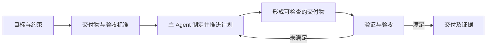
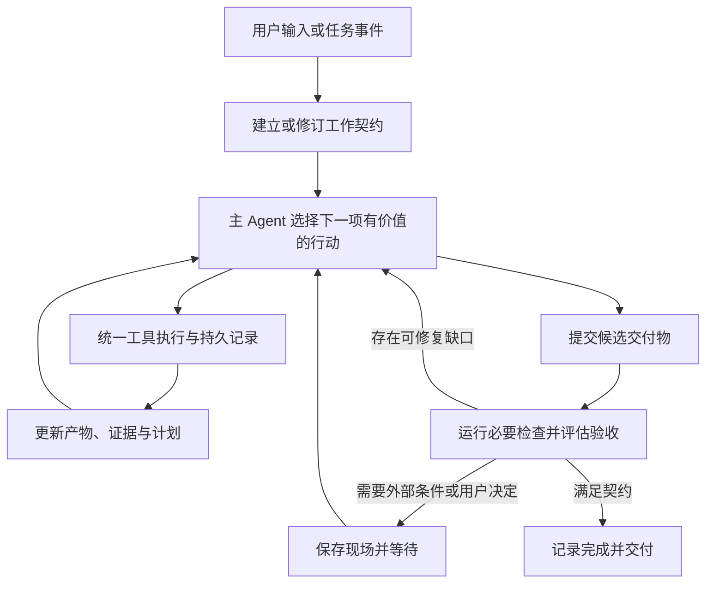

# MoonCode 设计演进与取舍

按原顺序保留 DSH 新材料后的目标重审、初版设计、无需兼容约束、自动化疑问及最终精简方案。早期方案保留为历史讨论；当前采用 [精简方案](CURRENT_PLAN.md)。完整进度更新见 [聊天原文](TRANSCRIPT.md)。

## 06 目标哲学与 DSH 新材料

原聊天轮次：`01a1a67d-b376-7003-a366-a5479242e6d6`

### 用户


# Files pasted by the user:

## "Super-agent 设计探索：迈向更自主的 Agent 系统 原创 DeepSeek 产品部 DeepSeek Harness 团队 2026年10月31…": /Users/kq/.codex/attachments/dafa36db-6b49-4947-85bc-d0ff6c002ac9/已粘贴的文本.txt

## My request:
rethink the question, the ultimate goal/philosophy of the system is clear produce quality deliverables in a top-down approach with minimal multi-agents. and we have a new paragraph from dsh explaining their future. 


### 助手完整答复

这会改变上一次比较的重点。我之前过多按“运行时能力是否齐全”来排序。按你明确的目标，MoonCode 应该围绕这个原则设计：

**从目标和验收标准出发，由一个主 Agent 对交付物负责；系统提供可靠执行、事实记忆和验证能力，只有在能改善交付结果时才增加 Agent。**

自主性的衡量，是用户需要操心多少、交付物是否可靠，以及修改意见能否持续落实。

**DSH 新文章带来的启发**

这篇文章首先是一份架构探索，开头明确说明它并非现有产品功能介绍。它讨论的核心瓶颈是：多项工作持续进入后，人的注意力被会话切换和上下文维护占满。因此，Router 与 Worker 的分离主要服务于**多任务连续性和响应效率**。

这与 MoonCode 的方向可以兼容，但需要区分两个问题：

- **跨任务调度：**用户同时推进几个交付物，如何避免相互阻塞。
- **任务内部执行：**一个交付物如何获得充分理解、连贯设计和可靠验证。

前者可以有多个独立执行上下文；后者默认应保持一个负责人。文章本身也区分了 Router 的高层分派与 Agent Team 的细节协调。[文章：双层架构](</Users/kq/.codex/attachments/dafa36db-6b49-4947-85bc-d0ff6c002ac9/已粘贴的文本.txt:1>)

尤其需要限定它的实验结论：编码工作被一个只消耗时间的工具替代，实验衡量的是调度与协作效率，不能据此推导多个 Worker 会提高代码质量。[文章：实验设置](</Users/kq/.codex/attachments/dafa36db-6b49-4947-85bc-d0ff6c002ac9/已粘贴的文本.txt:139>)

**MoonCode 的中心应该是交付闭环**

建议把系统的核心对象定义为一项持续演进的工作，包含目标、约束、验收标准、当前交付物、决策依据和验证证据。Session 是承载推理的上下文，可以压缩、更换或恢复；工作本身保持连续。

自顶向下的执行链路可以这样组织：



这里的“自顶向下”意味着每一步能解释它在解决哪个目标。计划应随证据调整，简单任务可以直接完成，复杂任务则逐步细化；不需要每次先生成完整任务 DAG。

MoonCode 已有一个很好的基础：目标协议区分 `Achieved / Blocked / Cancelled`，调度 quantum 耗尽也不会直接结束目标。[目标协议](/Users/kq/Workspace/moonclaw/mooncode/core/mooncode_goal_runtime_v1.mbt:1)、[执行语义](/Users/kq/Workspace/moonclaw/cmd/daemon/mooncode_capabilities.mbt:37)

下一步最值得补强的是：**从“提供了 criterion 对应的 evidence 引用”，走向“这些证据确实足以支持验收”。**引用覆盖只能证明记录完整，不能证明交付正确。

例如：

- 代码交付需要对应版本的构建、测试、行为检查，必要时验证实际应用。
- 文档交付需要检查内容覆盖、来源、内部一致性和最终渲染。
- 研究交付需要检查证据质量、不确定性和结论是否超出来源。

可以自动检查的交给程序；需要判断的使用明确标准进行评审；关键主观选择保留给用户。

**最少多 Agent 应成为执行策略**

默认一个主 Agent，负责理解、设计、实施、验证和最终整合。工具并发、后台命令和异步等待，通常已经能消除很多等待，无需新增推理角色。

增加 Agent 前，应能回答三个问题：

1. 它能带来什么可验证的收益：独立评审、专业能力，还是缩短关键路径？
2. 子任务能否用清楚的输入、输出、边界和验收标准表达？
3. 节省的时间或获得的质量，是否足以覆盖交接、重复读取和整合成本？

典型适用场景是边界清楚的调查、独立验证，以及用户同时提出的另一个完整任务。紧密耦合的设计与实现，应优先留在主 Agent 的连续上下文中。

每项工作只有一个最终负责人。子 Agent 返回结果和证据，主 Agent 决定是否采纳并承担整合责任。增加评审者也应有明确理由，避免默认形成规划者、执行者、评审者、仲裁者的固定链条。

**用这个目标重新回答原来的 16 个问题**

下面是对 MoonCode 的设计建议，区别于上一轮的现状盘点。

| 问题 | 应优先保障的行为 |
|---|---|
| **1. 输入到输出** | 用户意图形成可演进的目标与验收标准；执行不断产出交付物和证据；最终输出能直接检查、使用或接收。对话记录辅助理解，交付物承载结果。 |
| **2. Loop 与终止** | 以验收结果判断完成。步数、token、耗时和费用用于调度、预警及暂停；达到限制必须保存现场并说明未完成部分，不能视为成功。 |
| **3. 工具执行** | 使用统一管线完成参数校验、权限与授权绑定、执行隔离、结果规范化和持久记录；普通调用与脚本内嵌调用遵守相同规则。 |
| **4. 死循环** | 同时观察重复动作和目标进展。没有新证据、交付物变化或假设更新时，触发重新诊断、缩小范围、回退或暂停。允许有理由的重试。 |
| **5. 上下文** | 优先保留目标、约束、关键决策、未解决问题和证据入口；过程细节可压缩。原始材料可寻址，关键事实能从来源重新确认。 |
| **6. 多 Agent** | 默认单负责人；按明确收益委派有边界的任务。共享必要事实与版本，避免共享整份推理历史；负责人负责取舍和整合。 |
| **7. 并发修改** | 优先避免多个作者同时改同一交付物。必要时隔离工作区，合入前验证版本与行为；共享资源使用短事务、版本检查和适当粒度的锁。 |
| **8. 重启恢复** | 保存目标版本、计划位置、交付物版本、工具意图、已确认结果、待定副作用、审批及后台任务引用。恢复时先核对外部事实，再继续。 |
| **9. 人工介入** | 驳回属于新的约束或反馈，修改后续计划和相关验收依据。等待期间可继续独立且已授权的工作；超时保持待决，不能当作批准。 |
| **10. 大输出与失败** | 大输出保留完整来源及续读入口，窗口内提供足够判断的信息。重试区分无副作用读取、可幂等写入和结果未知操作；结果未知时先查证。 |
| **11. 工具与 MCP** | 工具组织围绕完成任务所需能力。稳定常用工具直接可用，长尾工具按需发现；MCP 解决接入，宿主统一执行政策。 |
| **12. RAG** | 在缺事实、来源、旧决策或验收依据时检索。任务关联引用优先，全文与语义检索补充；query 改写和 rerank 由召回质量决定。 |
| **13. 安全** | 外部事件、文档及工具返回保持来源与信任边界；它们不能自行扩大权限。凭据通过受控能力使用；危险副作用绑定当前授权与目标版本。 |
| **14. 线上评测** | 首先衡量交付是否通过验收、用户返工与介入次数，再看耗时、成本和工具错误。Agent 数量及协调开销也应纳入成本。 |
| **15. Badcase** | 从未满足的验收项反查：需求理解、设计、检索、执行、验证或交付出了什么问题，再定位模型、prompt、工具等技术原因，形成可复现回归任务。 |
| **16. 流式与重连** | 展示当前交付物、进展、阻塞和必要操作。重连恢复权威任务状态及交付版本；实时文字与已经持久确认的结果有清楚区别。 |

**从各项目采纳什么，优先级也要调整**

| 来源 | 最值得采纳 | 在这个目标下的取舍 |
|---|---|---|
| **OpenSeek** | 用真实 Agent 在隔离工作区完成任务，再独立检查最终产物；必要时为委派工作提供 worktree 与明确交接。 | 优先采用产物验证方法。自动创建大量 Worker 的价值低于提高单个负责人交付成功率。[评测实现](/Users/kq/Workspace/openseek/eval/prompt_task/README.md:1)、[工作区交接](/Users/kq/Workspace/openseek/agent_subagent/worktree.mbt:95) |
| **DSH 现有实现** | 统一工具执行管线，让校验、授权、守卫、执行和结果处理具有一致语义。 | 借鉴清楚的执行边界，按 MoonCode 的真实需要引入扩展点。[工具管线](/Users/kq/Workspace/dsh/docs/tool-execution-pipeline.md:5) |
| **DSH 新探索** | 事件过滤、已知任务直通、Inline & Spill、带关联引用的召回、异步后台操作，以及低打扰交互。 | Router 可以先是确定性路由加必要的语义判断；出现持续多任务需求后，再引入常驻 LLM Router。[上下文组织](/Users/kq/.codex/attachments/dafa36db-6b49-4947-85bc-d0ff6c002ac9/已粘贴的文本.txt:81)、[异步执行](/Users/kq/.codex/attachments/dafa36db-6b49-4947-85bc-d0ff6c002ac9/已粘贴的文本.txt:103) |
| **Pia** | 简洁的 Agent 核心，以及 Durable 对执行意图、恢复、嵌套调用身份和 replay policy 的明确表达。 | 重点借鉴可靠续跑语义。`replay: safe` 仍要求外部副作用具备相应幂等保障。[恢复契约](/Users/kq/Workspace/pia/packages/durable/README.md:277) |
| **MoonCode 自身** | 保留目标、证据、执行权限和持久事实之间的明确边界。 | 优先加强验收可信度、目标变更传播和交付物生命周期，让已有机制真正服务于完成工作。 |

对 DSH 文章还有三处需要补充工程约束：

- **共同订阅一个 Thread 可以帮助发现冲突，不能防止并发覆盖。**资源版本和写入协调仍不可少。
- **独立 Watchdog 有价值，但不必默认常驻另一个完整 Agent。**先用程序检测停滞、错误和异常，再按需调用模型诊断；修改主系统策略需要有版本和可回滚记录。
- **计算、状态、环境值得在接口上分离。**是否部署到云端，应由持续在线、设备访问和成本需求决定；远程端侧执行还需要可靠的操作身份与结果记录。

**MoonCode 接下来的建设顺序**

我会把优先级改为：

1. **建立可信的交付与验收闭环。**目标、交付物和验证证据关联到明确版本；用户改变方向后，旧结论能够被标记为需要重新验证。
2. **让单个主 Agent 更可靠地完成复杂工作。**补强上下文恢复、重复失败诊断、工具执行一致性，以及崩溃后的副作用核对。
3. **减少人的注意力负担。**后台操作不阻塞新输入；相关事件进入原任务；用户主要看到交付物、关键进展和需要其决定的事项。
4. **以真实任务评测决定是否增加 Agent。**比较单 Agent、有限委派和独立评审的验收质量、返工、总耗时及总成本，再决定默认策略。
5. **在持续多任务需求得到验证后扩展 Router、Watchdog 和远程环境。**

另外校正上一轮比较中的一处归属：匿名 baseline/variant 与阶段耗时 p50/p95 的具体实现来自 MoonClaw 的 `harness_replay`；OpenSeek 此次确认的是隔离工作区、真实任务运行和独立产物检查，二者不应混写。

## 07 初版设计与无需兼容约束

原聊天轮次：`01a1a685-03bb-7310-9654-555276a2e5b3`

### 用户

Turn this philosophy into a concrete MoonCode design and implementation plan grounded in the current code, prioritizing deliverable quality, trustworthy acceptance, and reliable single-agent execution.


### 用户

无需考虑兼容性


### 助手完整答复

建议把 MoonCode 收敛为一个**对交付结果负责的单 Agent 执行系统**：从目标和验收标准向下规划，由主 Agent 持续实施、验证、修正；运行时负责可信执行和恢复，验收规则决定是否完成。

按你的要求，下面直接设计目标形态，不保留旧协议、旧格式或兼容分支。本轮依据当前工作区源码制定计划，未修改代码、未运行测试。

**1. 当前基础与必须替换的部分**

当前代码已经具备不少需要的机制，主要问题是完成与验收规则分散。

| 当前实现 | 设计取舍 |
|---|---|
| Goal 区分 `Achieved / Blocked / Cancelled`；执行 quantum 耗尽不等于目标结束。 | 保留这项语义，纳入统一工作状态机。[目标协议](/Users/kq/Workspace/moonclaw/mooncode/core/mooncode_goal_runtime_v1.mbt:1) |
| Horizon checkpoint 校验里程碑证据、禁止擅改证据要求，最终完成要求修改后的验证。 | 复用证据检查能力；取消“过程里程碑全部完成就能证明交付完成”的独立判定。[里程碑校验](/Users/kq/Workspace/moonclaw/cmd/daemon/mooncode_runtime_horizon.mbt:588)、[完成判定](/Users/kq/Workspace/moonclaw/cmd/daemon/mooncode_runtime_model_planner.mbt:937) |
| `finish.goal_runtime` 检查 criterion ID 是否完整覆盖；Supervisor 从 finish 结果推导目标终态。 | 改为提交完成申请，由统一验收器决定结果。模型不能直接写入成功终态。[finish](/Users/kq/Workspace/moonclaw/cmd/daemon/mooncode_tools.mbt:1907)、[Supervisor](/Users/kq/Workspace/moonclaw/cmd/daemon/mooncode_goal_runtime_supervisor.mbt:154) |
| `quality_trial` 读取 `native_tests_passed`、`package_proof_ref` 等调用方字段。 | 声明仅用于解释意图；通过与否必须从可信执行记录推导。[质量判定](/Users/kq/Workspace/moonclaw/cmd/daemon/mooncode_quality_trials.mbt:1) |
| Package verified 当前可以由任意成功的 `shell` 或 `moon_check` 结果触发；外部 package-result 接口检查基本字段。 | 删除这类验证捷径，统一绑定具体检查、产物和版本。[包验证](/Users/kq/Workspace/moonclaw/cmd/daemon/mooncode_runtime_packages.mbt:186)、[上报校验](/Users/kq/Workspace/moonclaw/cmd/daemon/mooncode_package_results.mbt:76) |
| Journal 有锁、同步提交、幂等身份检查；continuation 引用已有工具结果，避免反复复制完整历史。 | 继续使用，作为唯一事实来源。[Journal](/Users/kq/Workspace/moonclaw/cmd/daemon/mooncode_session_journal.mbt:158)、[Continuation](/Users/kq/Workspace/moonclaw/cmd/daemon/mooncode_runtime_continuation.mbt:31) |
| MoonDesk 也有工作、证据和 package review 判定。 | MoonDesk 只显示运行时投影，删除本地验收推断。[当前 UI 领域模型](/Users/kq/Workspace/moondesk/mooncode/core/typed_work_evidence.mbt:44) |

尤其要消除当前的顺序风险：工具级 finish 结果先被记录，整轮 completion verdict 随后计算，而 Supervisor 又能从 finish 结果推导目标完成。目标设计只允许一条可信完成路径。

**2. 统一领域模型：工作、产物、证据**

只保留一套工作契约，不再并列维护 goal、horizon、quality trial 各自的完成标准。

| 对象 | 必要内容 |
|---|---|
| `WorkContract` | 工作 ID、修订号、目标、范围与约束、预期交付物、验收项、验收政策。 |
| `WorkState` | 当前契约修订、执行状态、计划、候选交付物、未满足验收项、待决操作。 |
| `ArtifactRevision` | 产物引用、内容摘要、来源工作修订、相关输入与环境指纹。可以是文件、目录、可执行包或回答。 |
| `VerificationSpec` | 检查哪些验收项、使用哪个检查器、检查范围、预期行为及检查器版本。 |
| `VerificationReceipt` | 检查对象版本、检查器与输入指纹、实际结果、完整输出引用、运行时来源。 |
| `Operation` | 稳定操作 ID、参数、权限依据、执行状态、结果和恢复策略。 |

这些是工作状态内部的记录，不另建一套通用项目管理或工作流系统。

三个事实需要明确区分：

- **Verified：**声明的必要检查通过。
- **Delivered：**对应版本的产物已经交付，用户能够访问。
- **Accepted：**指定验收方接受了该版本。

任务按照契约要求完成。普通任务可以要求 Verified 与 Delivered；只有明确要求人审的任务，才必须等待人工 Accepted。不能给每项工作额外增加一次用户确认，也不能把自动验证表述成用户已经接受。

契约与计划的修改权限不同：

- 主 Agent 可以调整计划、细分步骤、更新技术假设。
- 主 Agent 不能为了完成任务而删除验收项、降低标准或扩大权限。
- 用户改变目标时，形成新的契约修订；旧结果保留历史，新修订重新评估相关证据。
- 验收通过只对明确的契约修订和产物版本成立。

**3. 自顶向下的单 Agent 执行闭环**



默认执行策略：

- 每项工作只有一个主 Agent，负责理解、设计、实施、验证和整合。
- 不要求小任务先输出正式计划；复杂任务逐步展开计划。
- 独立且资源安全的观察可以并发；耗时命令可以后台运行。
- 默认不向模型暴露委派工具。明确允许委派时，才加载相应能力。
- 委派结果属于候选输入，仍由主 Agent 验证和整合。
- 不默认引入 Planner、Reviewer、Supervisor 等固定推理角色。

当前按“最多六次广泛发现、十二次发现后必须修改”的规则应替换。它能限制空转，但也可能奖励过早修改。新的判断应关注：**下一次行动能否消除具体不确定性、形成真实产物或验证一个假设。**

完成工具改为 `submit_candidate`。它提交候选产物和说明，不能提交 `achieved: true`。

**4. 可信验收：本轮设计的最高优先级**

验收器是确定性的领域规则，调用检查器取得证据；它不需要成为另一个常驻 Agent。

一次完成判定必须满足：

```text
当前契约修订匹配
且候选产物完整、可访问
且每个必要验收项都有合格证据
且证据绑定当前产物及相关输入
且不存在影响结论的未知操作结果
且满足契约要求的评审或交付条件
```

具体落实五项规则。

**证据必须有可信来源。**模型文字、工具输出中的“passed”、外部上报的 `package_verified` 都是观察或声明。只有受控检查器和授权评审入口可以创建相应 receipt。可信身份来自写入路径和授权，不能来自 JSON 中的 `source` 字符串。

**检查必须绑定实际版本。**优先对包含未提交修改的隔离快照运行验证。记录源码、依赖锁文件、检查定义、工具链及必要输入指纹；验证产物时再绑定构建结果摘要。不能假定 HEAD 就是被检查的内容，也不能要求用户先提交代码。

**检查必须证明对应行为。**零退出码只能证明命令成功。编译检查不能代替行为测试，截图存在不能代替交互验证，运行过 shell 更不能证明包已验证。每份 receipt 必须说明它支持哪些验收项、覆盖什么范围。

**检查依据不能被悄悄削弱。**允许 Agent 添加和修改项目测试，但独立验收检查的定义必须受控。检查器或预期结果改变后，需要重新建立验证依据；更新快照不能自动消除失败。

**证据自动失效。**产物、相关输入、契约或检查定义变化时，受影响的通过记录变为 stale。保留历史 receipt，重新运行必要检查，不重跑无关检查。

不同交付物使用不同检查配置，避免所有任务都套用“必须修改代码、运行 native tests、打包”的标准：

| 交付类型 | 典型验收依据 |
|---|---|
| 代码修改 | 请求行为的正反例、相关回归、构建与公共接口变化。 |
| UI 修改 | 目标界面的实际交互、必要状态、渲染检查；要求更新安装包时检查实际应用。 |
| 文档或方案 | 内容覆盖、来源、一致性、文件有效性及必要的最终渲染。 |
| 调查或无需修改 | 结论与证据链、问题是否已满足、未解决的不确定性；不能强制制造 mutation。 |

MoonCode 可以内置软件交付政策；其他产品的领域验收仍由所属产品提供，符合当前[责任边界](/Users/kq/Workspace/moonclaw/docs/RESPONSIBILITY_AND_TESTABILITY.md:1)。

**5. 可靠执行、恢复和上下文**

统一工具调用路径：

```text
完整响应解析 → 参数校验 → 契约与权限检查
→ 持久化操作意图 → 沙箱执行
→ 持久化结果 → 更新状态 → 回灌模型
```

这里需要几项具体改变。

- 移除猜测工具名、拆解相邻 JSON 对象等宽松执行修复。未知工具或非法参数返回明确错误；因输出截断而不完整的调用不执行。当前修复逻辑位于[模型调用解析](/Users/kq/Workspace/moonclaw/cmd/daemon/mooncode_runtime_model_planner.mbt:2219)。
- 操作 ID 由宿主生成并持久保存，恢复、重试和后台查询复用同一个身份。
- 操作状态至少覆盖 `Admitted / Running / Succeeded / Failed / OutcomeUnknown`。拒绝和取消分别记录，取消请求不能证明外部副作用未发生。
- 重启后先核对意图与执行 receipt。只读操作可以按政策重试；写入先检查预期前后状态；外部副作用只有具备幂等身份或可查询结果时才能自动续跑。
- 不承诺通用 exactly-once。无法查明结果时保留 `OutcomeUnknown`，不静默重放，也不判定完成。
- 保留当前精确授权与沙箱机制；未配置必要执行隔离时继续拒绝执行。

单 Agent 也需要资源协调：不同工作可能操作同一工作区。默认一个工作区只有一个写入负责人；观察并发按资源声明放行。构建、测试虽然通常不修改源码，却可能修改缓存和输出，不能一律按纯读取并发。未知效果默认独占。

短期记忆分两部分：

- **从事实重建的当前状态：**契约、产物、验收缺口、重要决策、失败假设、待决操作。
- **可压缩的过程记录：**探索细节、旧工具输出、重复讨论。

压缩不能改变第一部分。完整输出和原始材料通过稳定引用续读，引用包含版本或摘要。恢复时先重建当前状态，再加载必要上下文。

停滞检测也基于事实：重复动作与相同资源状态、重复失败诊断、长期未增加有效证据。触发后先诊断和调整行动；等待后台任务或外部条件不算空转。执行 quantum 用于让出调度和保存现场，不生成虚假的完成或阻塞结论。

**6. 代码组织与实施顺序**

领域类型和纯规则统一由 MoonClaw 的 `mooncode/core` 拥有；新增 `mooncode/runtime` 承载执行协调，通过接口访问模型、存储、工具、检查器和产物库。

`cmd/daemon` 保留 HTTP、配置和依赖组装。MoonDesk 消费同一套公共类型和状态投影，删除本地验收器。Journal 继续作为唯一事实来源，索引和 UI 状态均可重建。

以下新增文件名为实施建议，不表示当前已存在。

| 阶段 | 主要改动位置 | 交付与退出条件 |
|---|---|---|
| **1. 建立反例与统一契约** | `mooncode/core` 新增 `work_contract.mbt`、`work_state.mbt`、`acceptance.mbt`；扩展 `internal/harness_replay`。 | 固定当前错误接受风险的反例；统一契约、修订、产物和验收状态。未经授权不能降低标准。 |
| **2. 建立可信检查与候选产物** | 新增 `mooncode/runtime/verification.mbt`、`artifacts.mbt`；复用现有 sandbox、source inventory 和产物存储能力。 | 在隔离快照上运行检查并生成宿主 receipt；成功 shell、伪造报告、旧版本测试均不能通过验收。 |
| **3. 统一完成路径** | 替换 `mooncode_tool_finish_for_session`、Goal Supervisor、Horizon completion、quality trial、package verified 的独立判定。 | 只有验收器可产生完成事件；候选未通过时返回结构化缺口，主 Agent继续修复。不存在工具级完成早于整项验收的问题。 |
| **4. 实现可恢复操作执行** | 新增 `mooncode/runtime/operations.mbt`、`recovery.mbt`；改造 `mooncode_runtime_turn` 和 continuation 接线。 | 在执行前、执行后未记结果、已记结果未回灌等位置注入崩溃；无静默重复副作用，恢复结果可解释。 |
| **5. 收敛单 Agent 循环与上下文** | 新增 `mooncode/runtime/runner.mbt`、`context.mbt`、`progress.mbt`；替换分散 planner 控制逻辑。 | 目标跨压缩、暂停、重启保持一致；移除强制制造修改的规则；无需多 Agent 能完成代表性复杂任务。 |
| **6. 接入修改意见与人工决定** | 工作输入、审批和评审入口；改造当前 task controls、approvals、reviews。 | 中途改向创建契约修订；旧完成申请不能覆盖新指令；驳回后可续跑，超时不成为批准。 |
| **7. MoonDesk 交付界面** | 替换 `typed_work_evidence` 中的本地判定；更新 session projection 与 watch 消费。 | 用户可看到当前产物、验收缺口和待决事项；重连获得权威状态；不展示互相矛盾的“完成/未完成”。 |
| **8. 删除旧路径并完成质量评测** | 删除被替代的协议、规则和测试夹具；更新公共接口与文档。 | 不留双写或旁路；真实任务质量不退化，恢复及错误接受反例全部通过。 |

阶段 2 与 3 应作为第一个完整功能切片交付：**产物版本 → 可信验证 → 完成判定 → 用户可见结果**。不能只做类型重构，却继续让旧完成捷径生效。

首个贯通用例建议选择“修复一个已有行为缺陷”：

1. 从请求和项目事实形成验收项。
2. 主 Agent 完成修复及相关测试。
3. 捕获候选源码快照。
4. 独立执行行为检查和相关回归。
5. 失败则回到主 Agent修复。
6. 通过后交付同一版本的 diff、验证结果和说明。
7. 用户改变要求时，新修订使受影响的旧证据失效。

**7. 评测与发布门槛**

首先衡量交付质量：

- 独立检查通过率、错误接受率、用户返工与必要介入次数。
- 已交付内容与验证版本一致的比例。
- 重启后恢复成功率、未知副作用处理正确率。
- 总耗时、总模型成本、无效重复调用及协调开销。

必须覆盖的确定性反例包括：伪造测试通过、错误产物版本、测试后继续修改、契约中途变化、旧审批回放、工具截断参数、仅文档修改冒充代码修复、执行成功但进程在记账前崩溃，以及用户拒绝后的续跑。

真实模型评测使用隔离工作区和外部产物检查。先建立单 Agent 基线；只有有限委派在相同任务上改善质量或总耗时，并覆盖整合成本后，才考虑扩大默认能力。

性能验收也从第一阶段开始：复用增量状态投影，避免每步扫描完整 journal；checkpoint 保存引用，避免历史体积平方增长；关键意图和结果同步持久化，流式文字采用有界缓冲；源码摘要缓存必须在提交验收前重新确认。

开发时执行聚焦的核心、运行时和适配器检查；最终运行相关完整测试、`moon info`、`moon fmt` 并审查接口变化。UI 阶段还要验证断线、等待、失败、修订和实际交付状态。

**第一优先级是关闭错误接受路径，并让一个主 Agent 能依据可信的验收缺口持续修正。Router、多设备、常驻 Watchdog 和更复杂的多 Agent 协作排在这个闭环之后。**

## 08 自动化与两层架构讨论

原聊天轮次：`01a1a68c-a258-7f71-8c41-f41deec16be5`

### 用户

我有一个疑问，我们会不会增加了太多的hardening，然后导致系统完全半自动化。 因为自动化是保证用户体验的核心关键。 另外我们的系统架构会变成两层么？


### 助手完整答复

**有这个风险。上一版计划把验收门槛写得过重，应该调整。自动化必须是默认路径，hardening 的作用是让 Agent 更敢于、也更可靠地自动推进。**

**默认应当是一口气完成工作**

正常路径应该是：

> 理解需求 → 自主规划 → 执行 → 验证 → 自动修正 → 交付

检查失败、工具参数错误、上下文压缩、进程重启，原则上都由系统和 Agent 自行消化。它们不应自然演变成“等待用户处理”。

只有真正需要用户判断或授权时才介入，例如目标存在无法推断的关键取舍、必要行动超出了已有授权，或者外部条件确实无法自行恢复。用户已经授权的工作，不应逐步重复确认。

因此，上一版计划需要作三处修正：

| 上一版容易过重的地方 | 应调整为 |
|---|---|
| 每项交付都走完整、独立的验收流程 | 按任务选择必要检查；简单任务可以直接完成，复杂任务增加验证。 |
| 遇到证据缺口或异常就暂停 | 先自动补证据、诊断、修复和恢复；确实无法继续时才等待。 |
| 普遍要求隔离快照、严格检查器和评审记录 | 默认复用项目正常验证路径；在并发、可复现性或后果需要时增加隔离。人工评审由实际需求决定。 |

**hardening 应集中在少数系统必须保证的事实：**不越权执行、不悄悄重复危险副作用、不丢失已接收的工作、不把失败伪报为通过。这些约束可以由程序自动执行。

开放式的交付质量仍需要模型判断。不能把所有质量问题都变成硬规则，否则会不断增加“满足形式、无法完成工作”的情况。例如，调查任务不必制造文件修改，小修复不必经过整套打包流程。

验收器也应该帮助 Agent 找到下一步：返回“哪个要求尚未满足、已有何种证据、还缺什么”，让它继续解决。**自动完成率、用户介入次数和最终返工，应该共同约束 hardening 的设计。**

**架构上，默认不采用 DSH 式的常驻 Router Agent + Worker Agent 两层结构。**

MoonCode 当前更适合：

```text
用户 / MoonDesk
      ↓
MoonCode 工作运行时
  工作状态、输入队列、恢复、上下文、工具执行
      ↕
  一个主 Agent 的推理循环
      ↓
工具与执行环境
```

这里有职责分层，但只有一个主推理循环：

- **运行时代码**负责可靠接收输入、保存状态、执行工具和恢复现场。
- **主 Agent**负责理解目标、自顶向下规划、实施、判断质量和修正方案。

工作契约、验收检查、恢复机制都可以是这个运行时里的模块，不需要各配一个 Agent，也不需要再建一个独立调度平台。

即使执行耗时命令，也可以通过后台任务、输入队列和结果事件保持响应，无须专门增加 Router。将来用户同时推进多个独立工作时，可以让每项工作拥有独立执行上下文；已知归属的消息直接路由，只有模糊归属才需要模型判断。

所以我会把实施方向收窄为：**一个主 Agent 加一个可靠、轻量的运行时；先提高自主完成能力，再用真实瓶颈决定是否增加第二层 Agent。**

## 09 精简解决方案与改动计划

原聊天轮次：`01a1a691-151a-7922-8883-789cdc65df28`

### 用户

好的，按照这个版本和之前的所有讨论。 给出一个解决方案和改动方案。 要求多删不必要的代码，精简架构，少增实现。 


### 助手完整答复

建议采用**减法重构**：保留现有单 Agent 执行链，删除并行存在的目标与验收机制，只补齐完成判定和恢复中的必要缺口。

上一版提出的新 `mooncode/runtime` 框架、检查器注册系统、`submit_candidate` 工具和普遍隔离快照，这次都取消。继续使用现有 loop、journal、工具结果、continuation 和 `finish`。

**一、最终架构**

```text
MoonDesk：输入、产物、进展、必要决策
                  ↓
MoonCode：一份任务、一条执行循环
       模型 → 工具 → 结果 → 继续或完成
                  ↓
       现有 Journal 与执行环境
```

不增加常驻 Router、Reviewer 或 Watchdog Agent。运行时管理状态、执行和恢复；主 Agent 自顶向下理解需求、规划、实施、验证和交付。

同一任务默认一个主 Agent。后台命令和安全的工具并发继续复用现有实现。多个独立任务由现有服务调度，不增加一层 LLM 调度。

核心约束只有四项：

- 授权范围内自主完成，内部错误优先自行修复。
- 完成判断只有一个入口。
- 执行事实只有 journal 一个来源。
- 用户只处理真正需要其判断或授权的事情。

**二、只保留一份任务定义**

把当前 Goal、Horizon task contract 中必要的信息合并，沿用现有任务身份，不再增加 Work、Mission、Candidate 等平行实体。

任务最少包含：

| 字段 | 用途 |
|---|---|
| `id / revision` | 识别任务及用户修改后的版本。 |
| `objective` | 最终需要解决的问题。 |
| `constraints` | 范围、权限和用户约束。 |
| `outputs` | 应交付的代码、文件、回答或其他结果。 |
| `required_checks` | 用户要求、项目规范及任务性质确定的必要检查。 |

任务由输入和现有上下文自动形成，无需用户填写表单或先确认计划。Agent 可以细化计划、增加检查；不能靠修改计划消除已经确定的要求。

计划继续作为可调整的工作记录，**不承担完成证明，也不要求每项任务都创建里程碑**。执行续跑需要的 checkpoint 则保留。

用户提出新要求时，更新任务修订；相关旧证据重新评估。无需为此创建新 Session 或增加第二套目标状态机。

**三、合并完成判断，保留 `finish`**

继续使用 `finish`。它表示主 Agent 判断工作已经完成，运行时在同一个位置检查必要事实，然后决定是否结束。

```text
Agent 调用 finish
       ↓
统一完成判断
       ├─ 存在可修复缺口 → 返回缺口，Agent 继续
       ├─ 真正需要用户或外部条件 → 保存现场并等待
       └─ 满足要求 → 记录完成、交付结果
```

完成判断只负责少量可确定的条件：

1. 对应当前任务修订。
2. 应交付的结果存在或已经提供。
3. 必要检查具有实际成功结果，且没有被后续相关修改失效。
4. 没有影响结论的未知执行结果。
5. 用户明确要求的评审条件已经满足。

开放式质量由主 Agent 判断和修正，不尝试把每一条语义要求编译成检查规则。

不同任务自然采用不同标准：

- 修复代码：验证相关行为和必要回归。
- 修改 UI：检查受影响的交互及必要界面状态。
- 写方案：检查内容覆盖、事实依据和一致性。
- 调查问题：交付有依据的结论，可以没有文件修改。
- 目标已经满足：允许说明无需修改，并提供相应证据。

“检查通过”“已经交付”“用户接受”作为不同事实记录，但不再各建一套状态机。普通任务完成后直接交付；只有明确要求人审时才等待验收。

**四、具体删改清单**

| 代码区域 | 改动 |
|---|---|
| **旧 Goal 实现** | 删除 MoonCode 旧 `goal_contract`、`goal_reducer`、`goal_checkpoint`、`goal_comparison`、`goal_event_codec`，以及对应旧 API、store、supervisor lease/checkpoint/renew 实现。删除双 authority 检查和兼容分支。 |
| **当前 Goal Runtime** | 将必要的任务状态和终止语义并入统一任务模型；删除独立 genesis、扫描、投影及“从 finish 再推导完成”的重复机制。 |
| **Horizon** | 保留目标、约束、上下文入口和有用的进度记录；删除强制里程碑、不可重新打开的 done、按 mutation 数量分配完成资格等流程规则。 |
| **Quality trial** | 删除运行时独立质量关卡及其调用方声明字段。真实失败归因进入现有诊断记录；离线评测继续复用 harness。 |
| **Package verified** | 删除“成功 shell 即验证通过”的判断；包构建与验证直接引用对应工具结果。外部上报不能直接生成可信通过结论。 |
| **MoonDesk 验收逻辑** | 删除本地 package review 和 proof gate 推断；显示运行时投影。现有展示类型与解码代码按需要保留。 |
| **模型参数修复** | 删除猜工具名、拆相邻 JSON 对象等宽松执行逻辑。错误返回给模型自行修正；截断调用不执行。 |
| **强制推进规则** | 删除“发现若干次后必须修改”等规则和对应长提示词，避免为了过门槛制造修改。 |
| **重复协议描述** | 删除随上述机制失效的状态词汇、合同 JSON、能力声明和旧测试夹具，不保留废弃入口。 |

这些删除有明确的当前代码依据：

- [双 Goal authority](/Users/kq/Workspace/moonclaw/cmd/daemon/mooncode_goal_authority.mbt:1)同时扫描旧 Goal 和当前 Runtime。
- [Horizon 校验](/Users/kq/Workspace/moonclaw/cmd/daemon/mooncode_runtime_horizon.mbt:615)维护独立的里程碑完成规则。
- [Quality trial](/Users/kq/Workspace/moonclaw/cmd/daemon/mooncode_quality_trials.mbt:1)依赖多项调用方声明。
- [Package verified](/Users/kq/Workspace/moonclaw/cmd/daemon/mooncode_runtime_packages.mbt:186)使用过宽的验证依据。
- [MoonDesk package review](/Users/kq/Workspace/moondesk/mooncode/core/typed_work_evidence.mbt:362)另行推断验收状态。

删除范围限定为 MoonCode 专属机制。共享服务仍有使用者的能力按实际调用关系保留，不按文件名前缀批量清空。

**五、保留并小改的可靠性机制**

这些机制直接支撑自动化，应该保留：

- Journal 的顺序、同步提交和身份去重。
- 当前执行 lease、工具授权和沙箱执行。
- 已完成工具结果的持久记录与引用。
- 审批恢复、取消、后台命令和输入队列。
- 来源可追溯的上下文与完整输出续读入口。

只增加必要的小改动。

**工具执行前记意图，执行后记结果。**复用 journal 和已有执行身份，不新建 Operation 数据库。重启后可以分辨：尚未执行、已经完成、结果未知。

结果未知时，优先查询现有沙箱或后台执行 receipt；可安全重试的自动重试，写入操作核对实际状态。无法确定的外部副作用不盲目重放。

**验证结果补充版本关联。**在现有结果 metadata 中记录检查对象、相关输入版本和检查范围。验证期间协调本系统的写入；完成前重新确认相关内容。普通任务复用正常工作区，只有实际需要时才使用隔离快照。

**统一 continuation。**合并当前审批、quantum、transport、replan 等重复结构，使用一份续跑记录加原因字段；继续引用已有结果，避免复制完整历史。

**缩短提示词。**稳定的权限、协议、持久化规则由程序保证；提示词保留目标、当前事实、必要约束和行动原则。不要让提示词继续承担越来越多的流程补丁。

当前 [runtime turn](/Users/kq/Workspace/moonclaw/cmd/daemon/mooncode_runtime_turn.mbt:1)约 2,625 行，[model planner](/Users/kq/Workspace/moonclaw/cmd/daemon/mooncode_runtime_model_planner.mbt:1)约 3,293 行。应先删除重复职责，再按职责拆分；单纯移动文件不计作精简。

**六、实施顺序**

建议分五个可独立审查的改动，避免一次重写整个运行时。

| 顺序 | 改动内容 | 完成标准 |
|---|---|---|
| **1. 删除旧 Goal** | 移除旧协议、旧 supervisor 与双 authority；暂时保持当前执行行为。 | 旧实现及引用消失；现有运行、暂停和恢复仍正常。 |
| **2. 合并完成判断** | 合并任务定义、Horizon、Goal Runtime 和 quality trial；保留 `finish`。纯规则放进现有 `mooncode/core`。 | 唯一完成入口；不完整 finish 能自动继续；不再要求制造 mutation。 |
| **3. 收紧证据、打通恢复** | 修正 package verified；补执行意图和检查版本；统一 continuation。 | 旧版本证据不能通过；崩溃后不静默重复副作用；正常工作无需新增人工操作。 |
| **4. 简化 Agent 路径** | 删除强制发现次数、宽松参数修复和重复提示词；默认不挂载委派工具。 | 一个 Agent 可持续完成代表性任务；错误能够自动修复。 |
| **5. 简化 MoonDesk** | 删除前端完成推断，接入统一状态，清理废弃声明和测试。 | 用户看到产物、进展和必要决策；刷新重连后状态一致。 |

每个改动都应同时删除被替代的实现，不双写、不留“以后删除”的兼容层。第一轮不新增包、数据库或通用扩展框架；确实需要新增的主要是现有 core 中的小型任务与完成规则，以及少量 journal 记录字段。

**七、验收这个改造的标准**

不能只看代码减少量。需要同时满足：

- 生产代码净减少；状态机、写入口、配置项和提示词分支减少。
- 普通任务不增加用户确认步骤。
- 检查失败、参数错误、压缩和重启后，能自行继续的工作仍自行继续。
- 成功 shell、旧版本测试、伪造通过声明不能成为完成依据。
- 不丢失用户指令，不重复执行无法确认的外部副作用。
- 同一组真实任务的交付质量不退化，用户介入和返工不增加。
- 启动、交互、总耗时及构建成本没有因重构增加不必要开销。

测试复用现有用例和 harness，把关键行为迁到唯一执行路径；随旧机制删除的测试，不作为质量提升证据。最终运行相关测试、`moon info`、`moon fmt`，并检查公共接口和实际 UI 状态。

这次改造的主体应当是：**删掉旧 Goal，合并完成判断，修正证据来源，复用现有恢复机制，删除 MoonDesk 的重复推断。**


