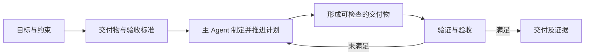
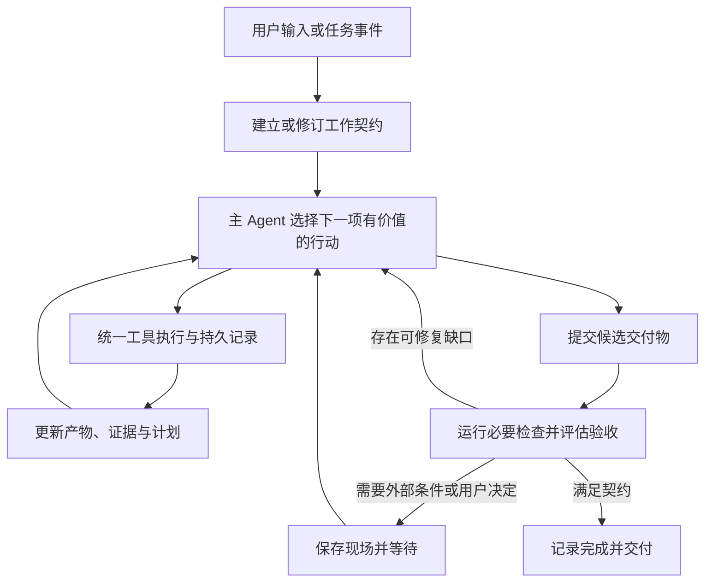

# MoonCode 架构与交付设计完整讨论

日期：2026-11-04（Asia/Shanghai）。以下按原聊天顺序保留用户消息、助手进度更新和完整答复；历史意见不因后续修正而改写。当前采用的取舍见 [README](README.md)。不包含工具执行输出、系统指令或内部推理。

## 01 MoonCode 的 16 个问题

原聊天轮次：`01a1a660-2157-7302-8e4b-f31aa3c52169`

### 用户

answering this question (mooncode) 1、讲清楚从用户输入到最终输出的全链路，每一环的输入输出是什么
2、Harness 里 agent loop 怎么设计，终止条件除了 max turns 还有哪些(token/耗时/预算/重复动作)
3、模型返回 tool call 后，怎么做参数校验、权限校验、沙箱执行和结果回灌
4、Agent 陷入死循环或重复调用同一个工具怎么检测和处理(状态指纹/去重/回退)
5、长上下文超限时，短期记忆怎么压缩，摘要丢失关键信息怎么补，跨块关联怎么保证
6、多 Agent 协作时，任务怎么拆分、状态怎么共享、结果冲突怎么仲裁
7、多个 Agent 并发改同一个文件/资源，怎么防冲突，锁粒度怎么定
8、Agent 执行到一半服务重启，checkpoint 存什么、放哪、怎么恢复现场
9、human-in-the-loop 场景，用户驳回或超时时，任务怎么续跑和兜底
10、工具返回数据过大怎么截断/摘要，工具失败怎么重试、熔断、保证幂等
11、Function Calling 和 MCP 分别解决什么问题，工具太多时怎么检索和按需加载
12、RAG 在 Agent 里什么时机触发检索，query 改写和 rerank 怎么接
13、Prompt 注入怎么防，危险工具调用怎么拦截，敏感数据怎么脱敏
14、Agent 线上怎么评测:任务成功率、工具选错率、参数错误率、成本、耗时怎么埋点
15、badcase 怎么归因到模型 /prompt/ 检索 /工具，怎么回流成回归集
16、流式输出下，工具调用事件怎么往前端正向推送，断线重连怎么恢复


### 助手进度更新

我会先查看仓库里 mooncode 的实现，按这 16 个问题整理回答，并区分已有实现、当前限制和可选改进。

### 助手进度更新

我会使用 moonbit-agent-guide 核对代码结构和运行边界。回答会以当前源码为准；未找到实现的能力会标成设计建议。

### 助手进度更新

已确认一个关键边界：MoonCode 是 MoonClaw 的角色/配置，MoonDesk 负责交互和事件展示。当前运行时还把 `max_turns`、`planner_max_steps` 视为可续跑的执行批次，不能直接解释成“任务预算耗尽”。接下来我会重点核对重复调用检测、压缩恢复、审批和并发写入。

### 助手进度更新

目前已看到几处具体机制：独立 worker 工作根目录校验、会话执行锁、重复完整读取和重复失败验证的拦截、可恢复的 planner checkpoint。也有需要明确的限制：知识检索目前是文本/向量混合打分；工具按需加载和语义压缩受配置开关控制，不能概括成默认启用了 query rewrite、rerank 或自动摘要。

### 助手完整答复

下面按 **MoonCode 当前实现 + 需要补齐的工程设计** 回答。标为“建议”的内容，不代表已经实现。

先明确边界：**MoonCode 是 MoonClaw 的编码角色，MoonClaw 承担 Agent runtime；MoonDesk 负责输入、控制、审批和结果展示。** [架构说明](/Users/kq/Workspace/moondesk/README.md:22)

**1、从用户输入到最终输出，全链路每一环的输入输出是什么？**

主链路是：**输入 → 持久化命令 → 领取任务 → 组装上下文 → 模型规划 → 工具执行 → 结果回灌 → 验收 → 展示。**

| 环节 | 输入 | 输出 |
|---|---|---|
| 用户提交 | 文本、附件、工作根目录、模型选择 | 带 `session_id`、`command_id` 的命令包 |
| 接收与持久化 | 命令包 | journal 命令记录、排队事件、顺序号 |
| Runtime 领取 | 可执行命令、会话控制状态 | claim，或 busy、cancel、等待状态 |
| 上下文组装 | 用户任务、AGENTS.md、检索材料、历史结果、steer | 本轮模型 messages 和工具定义 |
| 模型规划 | messages、工具 schema | assistant 文本或带 ID 的 tool calls |
| 校验与授权 | 工具名、参数、任务范围、权限策略 | 可执行调用、审批请求或结构化拒绝 |
| 工具执行 | 已授权调用 | 输出、错误、退出码、文件变化、执行证据 |
| 结果回灌 | 工具结果和 `tool_call_id` | 下一轮模型上下文 |
| 完成与交付 | `finish`、里程碑、验证证据 | 完成回执、回答、diff、产物引用 |
| 前端展示 | journal 的事件/会话投影 | 对话、工具状态、审批和最终结果 |

交互主入口 `/turns` 会持久化命令并启动或复用 runtime service。前端应以运行时证据更新状态；收到请求只能说明“已接收”，不能说明“已完成”。

另外，**命令执行完成、目标达成、用户接受修改，是三个不同事实。** [运行时契约](/Users/kq/Workspace/moonclaw/cmd/daemon/mooncode_capabilities.mbt:37)

**2、Harness 里的 agent loop 怎么设计？除了 max turns，还有哪些终止条件？**

我会把 Harness 定义为一个**可持久化、可暂停和恢复的状态机**。每轮依次检查控制信号、恢复点、工具结果和完成条件，再决定是否继续规划。

MoonCode 当前有两层循环：

- 外层 runtime loop：领取命令，执行 turn，处理 idle、审批、取消、失败和暂时中断。
- 内层 planner loop：模型产出工具批次，执行、回灌，再规划。

关键区别是：`max_turns` 和正数 `planner_max_steps` 是**调度批次上限**。耗尽批次可以保存 checkpoint 后续跑，不能因此宣称目标完成。当前 goal-runtime 的终态是 `Achieved`、`Blocked`、`Cancelled`；普通 `finish` 不自动结算目标。

如果产品要支持总 token、金额、耗时预算，建议单独增加预算控制器：

- 执行前检查剩余额度，并为并发调用预留额度。
- 执行后根据实际 usage、工具费用结算。
- 子 Agent 消耗计入父任务总账。
- 预算耗尽进入可解释的暂停状态，保留现场。

**当前 criteria-only goal-runtime API 不接受聚合预算，不能把旧预算代码当成现有能力。** [循环实现](/Users/kq/Workspace/moonclaw/cmd/daemon/mooncode_runtime_loop.mbt:126)、[目标契约](/Users/kq/Workspace/moonclaw/mooncode/core/mooncode_goal_runtime_v1.mbt:1)

**3、模型返回 tool call 后，如何做参数校验、权限校验、沙箱执行和结果回灌？**

执行链应该有四道边界：

1. **解析与参数校验**：解析 JSON，校验工具是否存在、必填项、类型、范围，以及工具特有约束。例如行号合法、替换文本唯一匹配。
2. **权限与范围校验**：检查会话和工作根目录、任务是否只读、操作是否需要审批。模型填写的 `requires_approval=false` 不能产生授权。
3. **执行隔离**：进程工具绑定具体 sandbox grant，限制命令、目录、网络、资源和超时。
4. **结果归一化**：返回成功/失败、输出、退出码和证据，以原 `tool_call_id` 回灌模型。

MoonCode 当前采用工具 schema 加各工具的手写校验；**不能说已经统一实现了所有 JSON Schema 的运行时验证**。MCP 转发层也需要补充对远端 `inputSchema` 的本地校验。

当前直接 `/tool-exec` 返回 503；Agent 进程执行路径在沙箱路由缺失时拒绝执行。审批后的进程调用使用已持久化绑定的参数，避免批准后替换命令。 [工具入口](/Users/kq/Workspace/moonclaw/cmd/daemon/mooncode_tools.mbt:1)、[审批执行绑定](/Users/kq/Workspace/moonclaw/cmd/daemon/mooncode_runtime_turn.mbt:640)

**4、死循环或重复调用同一个工具，怎么检测和处理？**

检测重点是**重复动作是否产生新信息或推进状态**，不能只统计工具名字。

MoonCode 已有具体拦截：

- 相同验证调用已经失败，且之后没有净源码变化，拒绝再次执行。
- 已完整读取、证据仍被保留的文件，限制重复整文件读取。
- 实现任务连续发现源码、没有实质修改时，达到 6 次广泛发现或 12 次总发现后拦截继续发现。
- 精确行范围读取、修复 patch 上下文不匹配等情况保留恢复通道。

进一步建议维护动作和状态指纹：

`工具名 + 规范化参数 + 相关资源版本 + 当前任务阶段`

配合滑动窗口识别 A→B→A 循环和无进展状态。处理顺序是：返回已有证据或拒绝重复动作 → 回灌具体原因 → 重新规划 → 必要时暂停并请求用户处理。

回退必须限定为本任务有记录的修改，不能用整个工作区 reset 处理循环。 [重复验证检测](/Users/kq/Workspace/moonclaw/cmd/daemon/mooncode_runtime_turn.mbt:2187)、[发现饱和检测](/Users/kq/Workspace/moonclaw/cmd/daemon/mooncode_runtime_turn.mbt:2357)

**5、长上下文超限，短期记忆怎么压缩？丢失信息怎么补？跨块关联怎么保证？**

要区分**模型当前上下文**与**持久化证据**：前者是工作集，后者支持恢复和核实。

MoonCode 默认压缩会保留前置系统约束、完整任务契约和近期消息；超过 32 条消息时保留约 24 条近期后缀，并保留部分较早推理锚点。较大工具结果在后续请求中保留有限的头尾内容，同时生成累计证据账本。

还有可选的上下文压力压缩路径，但默认关闭；启用后会检查指令、来源元数据和 tool-call/result 协议是否保持，失败则放弃该次压缩。

补偿机制应包括：

- 长期保留目标、用户约束、未完成事项、审批和验证结论。
- 用 `command_id`、`tool_call_id`、journal sequence、路径和行号关联证据。
- 对缺失事实按引用重新读取，避免把摘要当成事实原件。
- 关键结论记录依赖的证据，关联资源变化后使结论失效。

**结构完整性检查无法保证摘要语义完全无损**，关键决策仍要允许回看原始证据。 [默认压缩](/Users/kq/Workspace/moonclaw/cmd/daemon/mooncode_runtime_model_planner.mbt:1412)、[可选压缩校验](/Users/kq/Workspace/moonclaw/cmd/daemon/mooncode_semantic_compaction_trial.mbt:464)

**6、多 Agent 协作时，怎么拆任务、共享状态、仲裁结果冲突？**

拆分依据是依赖关系和资源所有权。每个子任务需要明确目标、输入、产物、验收条件、允许修改范围和依赖；前置输入不完整的任务不能提前运行。

MoonCode 当前的 `spawn_workers` 创建普通子会话，要求调用方提供隔离的工作根目录。父子关系先持久化，再启动子任务。`wait_workers` 按 any/all 汇总状态，结果绑定到被委派的具体 command，而不是子会话最新消息。

状态通过 journal 和结果引用共享；产物引用本身不授予跨目录访问权限。

结果仲裁应由父 Agent 根据任务契约、测试和证据完成。有冲突时比较前提、资源版本和验证结果；必要时独立复验或交给用户。**当前没有证据表明已实现通用的自动语义冲突仲裁。** [Worker 实现](/Users/kq/Workspace/moonclaw/cmd/daemon/mooncode_workers.mbt:33)、[结果投影](/Users/kq/Workspace/moonclaw/cmd/daemon/mooncode_worker_results.mbt:2)

**7、多个 Agent 并发改同一个文件/资源，怎么防冲突？锁粒度怎么定？**

MoonCode 当前已有：

- 会话级 execution lease，阻止多个 runtime 同时执行同一会话。
- journal 排他锁，保证记录顺序和记录身份去重。
- 同批 worker 根目录互不重叠。
- 工具批次区分可并发读取、独占修改和结束边界。

这些机制**不等于跨所有会话的文件锁**：不同会话指向同一目录，仍需要资源级协调。

建议优先用独立 worktree，由集成者合并。确实要共享写入时：

| 资源 | 建议并发控制 |
|---|---|
| 单文件修改 | 文件版本/hash 校验，加短期写锁 |
| 多文件原子修改 | 一次获取相关锁，固定获取顺序 |
| Git index、提交 | 仓库级锁 |
| 构建目录、依赖安装 | 按共享目录或工具资源加锁 |
| 远端记录 | ETag/version 条件更新或服务端事务 |

修改提交时再次校验版本；冲突后重新读取、重新生成 patch。锁不要跨模型推理或人工等待持有。 [工具调度分类](/Users/kq/Workspace/moonclaw/cmd/daemon/mooncode_tool_effects.mbt:2)

**8、执行中服务重启，checkpoint 存什么、放哪、怎么恢复？**

MoonCode 使用选定工作区对应的 MoonClaw 产品数据目录，保存 `mooncode/sessions/<session-id>/` 下的会话数据；**journal 是命令、事件和回执的有序权威来源**。

当前 continuation 会记录：

- command 和执行阶段。
- planner plan、step/tool 索引。
- 已完成工具结果或其 journal 引用与摘要。
- 待审批调用及审批身份。
- transport 中断位置、待处理 steering 等。

恢复时重放 journal，取得执行所有权，找到未完成命令及最近有效 continuation，再从未完成边界继续。已有完成证据的工具不能重复执行。

最难的是：**外部动作已经成功，但服务在写完成回执前崩溃。** 此时需要工具端幂等键或查询接口确认状态；无法确认就进入待核实状态，不能盲目重试。对外部副作用不能仅凭 checkpoint 承诺 exactly-once。 [Continuation](/Users/kq/Workspace/moonclaw/cmd/daemon/mooncode_runtime_continuation.mbt:85)

**9、human-in-the-loop 下，用户驳回或超时，任务怎么续跑？**

审批应当是持久化等待状态，绑定**具体操作和参数**。

MoonCode 会先记录 pending approval 和 continuation。用户批准后，从等待位置继续；用户拒绝后，将“未执行”和拒绝原因作为结果回灌模型，再选择符合新约束的路径。

超时仍保持 pending，不能自动视为同意。当前 runtime service 遇到审批会及时让出执行；直接等待模式另有等待时限。

还需要区分：

- “拒绝这一次操作”：允许其他合规方案。
- “禁止这类操作”：形成后续任务约束。
- “取消任务”：进入取消流程。

恢复后应重新检查资源版本和授权有效性；操作内容发生变化时，旧审批不能覆盖新动作。 [审批机制](/Users/kq/Workspace/moonclaw/cmd/daemon/mooncode_runtime_approvals.mbt:2)

**10、工具数据过大怎么截断？失败怎么重试、熔断、保证幂等？**

输出处理要分两层：

- **执行层**限制捕获大小，防止内存被打满。
- **上下文层**保留诊断、摘要和引用，控制模型输入成本。

MoonCode 已有带 `truncated`、原长度和上限的截断，以及保留进程输出头尾的处理。但如果输出在捕获阶段已经被丢弃，后续摘要无法恢复；需要原文时，应在执行阶段保存受限产物。

失败按类别处理：

- 参数或权限错误：修正或等待授权。
- 确定性业务失败：先修复原因。
- 网络抖动、429、临时服务错误：退避、抖动、遵守服务端重试提示。
- 副作用结果未知：先查询执行状态。

当前特定模型 transport 已有退避重试和过载请求压缩，部分路径可持续重试直到取消；**这不是所有工具统一的熔断策略**。

建议按服务维护 closed/open/half-open 熔断状态；写操作使用稳定的逻辑操作 ID 作为幂等键，并校验参数摘要。 [输出限制](/Users/kq/Workspace/moonclaw/cmd/daemon/mooncode_tools.mbt:2041)、[模型重试](/Users/kq/Workspace/moonclaw/cmd/daemon/mooncode_runtime_model_planner.mbt:320)

**11、Function Calling 和 MCP 分别解决什么？工具太多怎么按需加载？**

**Function Calling** 解决模型如何结构化表达“调用哪个函数、参数是什么”。  
**MCP** 解决客户端如何发现和调用外部服务提供的工具、资源等能力，覆盖连接、协议协商和交互规范。两者可以串联：

`模型 function call → Harness 校验与授权 → MCP tools/call → 结果回灌`

MCP 协议本身不会替 Harness 完成业务授权。[MCP 规范](https://github.com/modelcontextprotocol/modelcontextprotocol/blob/main/docs/specification/2026-07-28/basic/index.mdx)

MoonCode 有可选动态工具包和 `tool_search`：基础工具先加载，检索命中的工具在下一轮模型请求中加载，单次最多返回 5 个。MCP 通过 `mcp_list_tools` 和 `mcp_call_tool` 发现、调用工具。

工具检索结果还要受权限过滤；命中工具只表示“发现能力”，不能表示“获得执行许可”。 [按需发现](/Users/kq/Workspace/moonclaw/cmd/daemon/mooncode_deferred_tools.mbt:2)

**12、RAG 什么时候触发？query 改写和 rerank 怎么接？**

MoonCode 当前在每轮附加工作区上下文时，用任务文本检索知识库，再把片段作为来源材料注入上下文。

现有检索采用关键词打分，可叠加 embedding 相似度，排序后最多取 12 个片段；带来源、提取文本行号和引用。**当前这条路径没有独立的 query rewrite 或 cross-encoder rerank。**

需要增强时可以接成：

`任务/缺失事实 → query rewrite → 权限过滤后的混合召回 → 去重 → rerank → 补充关联片段 → 上下文`

改写应保留代码符号、版本和用户约束。除任务开始外，也可在发现事实缺口、工具失败需要文档、压缩后缺失关键证据时触发。已有有效证据无需每一步重新检索，以减少延迟和成本。 [检索入口](/Users/kq/Workspace/moonclaw/cmd/daemon/mooncode_book_instructions.mbt:2)、[当前排序](/Users/kq/Workspace/moonclaw/cmd/daemon/mooncode_knowledge_context.mbt:2)

**13、Prompt 注入怎么防？危险调用怎么拦？敏感数据怎么脱敏？**

核心是：**外部内容不能获得指令权限，模型输出不能获得执行权限。**

MoonCode 已有来源元数据；检索片段明确作为材料而非指令；危险进程操作经过审批和 grant 绑定。MCP 返回内容会处理配置 token 的脱敏，安全 stream 投影也过滤部分私有路径和 reasoning。

仍需分层加强：

- 外部网页、文档、工具描述和返回值按不可信数据处理。
- 服务端授权独立检查主体、操作、资源和目的地。
- 凭证通过受控执行环境注入，避免进入模型上下文。
- 模型入口、工具出口、日志和产物分别执行脱敏。
- 远端工具描述、schema、版本变化后重新审核。

来源标签和关键词黑名单都不足以证明防注入。路径字符串检查也不能替代操作系统隔离。这与 OWASP 对 Excessive Agency 的控制方向一致。[OWASP](https://genai.owasp.org/llmrisk/llm062025-excessive-agency/)

**14、线上怎么评测成功率、选错工具率、参数错误率、成本和耗时？**

先统一口径，再埋点：

| 指标 | 判定方式 |
|---|---|
| 任务成功率 | 验收条件满足且证据有效；不能只看 `finish` |
| 工具选错率 | 标注或复核发现的错误选择 / 可评估选择 |
| 参数错误率 | 参数校验失败调用 / 工具调用 |
| 成本 | 实际输入、输出、缓存 token 费用，加工具费用 |
| 耗时 | 排队、上下文构建、模型、工具、验证、人工等待分别记录 |

链路用 task/session/command/tool-call ID 贯通，同时记录模型、prompt、工具和检索版本。耗时看 p50/p95，并关注首次可见反馈、重试放大和恢复时间。

MoonCode 已有实际 usage、缓存、请求大小、工具 schema 大小等 planner metrics，以及分阶段延迟和 baseline/variant 回放框架。**这些代码不能直接证明已经有完整线上看板或线上成功率数据。** 缺失 usage 应标为未知，不能按零成本计算。 [Planner metrics](/Users/kq/Workspace/moonclaw/cmd/daemon/mooncode_planner_metrics.mbt:38)、[阶段指标](/Users/kq/Workspace/moonclaw/internal/harness_replay/phase_metrics.mbt:2)

**15、badcase 怎么归因到模型、prompt、检索、工具？怎么回流回归集？**

先定位**最早偏离正确行为的步骤**，然后做控制变量回放：

- 正确证据已在上下文，仍错误决策：检查模型或提示约束。
- 该召回的证据缺失、排序过低：检查检索。
- 原始证据有，压缩后丢失：检查记忆机制。
- 调用及参数正确，工具返回错误：检查工具或环境。
- 重复执行、审批错绑、乱序：检查 Harness 和恢复逻辑。

不能只看最终回答就归因给模型。应固定环境和其他输入，分别替换检索结果、prompt、工具结果，观察问题是否消失。

回归用例保留最小必要的初始状态、输入、工具 fixture、验收器和禁止行为。确定性故障做离线测试；模型决策做多次统计评测。

MoonCode 已有匿名 baseline/variant 回放和按任务类型分组的比较，但不能据此宣称自动根因归因已完成。 [回放验证](/Users/kq/Workspace/moonclaw/internal/harness_replay/replay.mbt:19)

**16、流式输出下，工具事件怎么推给前端？断线怎么恢复？**

建议由后端产生明确事件：规划、工具等待审批、工具开始、输出片段、工具结束、任务结束。每条事件携带 session、command、tool-call、event ID 和顺序号。

模型流式参数尚未收齐时，只能展示组装状态；**完整解析、校验和授权通过后才能执行工具**。

MoonClaw 当前提供 JSONL/SSE 格式和游标回放；MoonDesk 当前主要使用会话 watch 长轮询刷新，因此不宜描述为已实现一条持续的端到端 SSE 推流。

重连流程应是：

1. 客户端提交最后成功应用的 cursor。
2. 服务端回放该位置之后的事件。
3. 客户端按事件身份去重，并按 tool-call 更新对应工具卡片。
4. cursor 过期、出现缺口或回放超限时，重新读取权威快照。

现有可选 typed resume 契约会校验 stream 绑定、检测 cursor 异常，并在回放窗口超限时返回 409。前端切换会话还使用 generation 隔离旧请求。网络响应不应持有 journal 锁，否则慢客户端会拖住 Agent。 [恢复协议](/Users/kq/Workspace/moonclaw/cmd/daemon/mooncode_stream_resume.mbt:2)、[前端 watch](/Users/kq/Workspace/moondesk/ui/rabbita-desk/main/mooncode_session_watch_commands.mbt:11)

## 02 OpenSeek 的 16 个问题

原聊天轮次：`01a1a666-08f7-72a2-ba3d-ad9f1a512396`

### 用户

answer the same question with latest ../openseek


### 助手进度更新

我会检查 `../openseek` 当前源码，按同样的 16 个问题回答，并区分已实现的机制、默认行为和仍需补齐的部分。

### 助手进度更新

当前检出版本是 2026-11-04 的 `dbe35ecc`，工作区干净。相比前面 MoonCode 的实现，OpenSeek 的主要差别是：通过 `mbtx` 编排工具、用追加式会话日志保存记忆、在上下文接近上限时压缩并让出当前 turn；MCP 工具通过脚本中的目录检索调用，不全部放进模型的函数列表。我会继续核对审批、沙箱、子 Agent 和重启恢复的边界。

### 助手进度更新

已核对出几个重要限制：没有发现通用的“重复动作＋状态指纹”防循环器；当前沙箱能力因执行路径和平台而异，不能概括为完整进程隔离。会话日志可以恢复对话，但内存中的审批等待和后台进程不会随日志恢复。评测上也要区分 `Finished` 与真正通过任务验证。接下来会检查桌面端的断线补偿，以及最新子 Agent 的结果交接。

### 助手完整答复

以下基于本地 `../openseek` 当前检出的 **`dbe35ecc`（2026-11-04）**。下面区分当前实现和建议补齐项；实现判断以源码为准。

与前面的 MoonCode 不同，**OpenSeek 自己拥有 Agent loop**。CLI、TUI、Desktop 共用引擎；`serve` 从 stdin 接收 JSONL 命令，通过 stdout 输出类型化事件，追加式 session 日志保存对话状态。[架构](/Users/kq/Workspace/openseek/docs/architecture.md:7)

**1、从用户输入到最终输出，全链路每一环的输入输出是什么？**

| 环节 | 输入 | 输出 |
|---|---|---|
| 接收输入 | prompt、图片、session、模型及运行选项 | 类型化命令；开始 turn 或进入待执行队列 |
| 构造会话 | 系统提示、工作区指令、skills、已有日志 | `Session`；用户输入追加为 `User` 事件 |
| 构造模型请求 | `Session.chat_messages()`、工具定义 | provider chat 请求 |
| 模型推理 | messages、function schemas | 流式文本、usage、完整 assistant/tool calls |
| 工具解析 | 工具名、原始 JSON 参数、调用 ID | 已解析的 `AgentToolCall`，或解码错误 |
| 校验与执行 | 类型化参数、文件状态、权限、运行能力 | `Respond(ToolOutput)` 或 `Control(...)` |
| 结果回灌 | 工具输出、错误、图片、调用 ID | 持久化 `Tool` 事件和下一轮模型消息 |
| 结束 turn | 普通最终回答或 `finish` 等控制结果 | `Finished`、`ContextYield`、`Failed` 等终止记录 |
| 前端展示 | 实时协议事件、持久化 session 事件 | 回答、工具结果、审批、后台任务状态 |

工具主要包括 `mbtx`、文件修改、后台任务、plan/goal/finish，以及配置后可用的子 Agent。`mbtx` 编译并运行 MoonBit 脚本，也能通过 SDK 调用宿主工具和 MCP。

关键保证是：**模型消息缓冲区在持久化追加成功后才更新**，避免模型已看到结果、磁盘却没有记录。但命令被接收、排队，不等于用户消息已经持久化。[主循环](/Users/kq/Workspace/openseek/agent/turn_loop.mbt:140)

**2、Harness 里 agent loop 怎么设计？除了 max turns，还有哪些终止条件？**

当前每个 step 是一次模型请求，然后处理该响应的工具批次。step 边界应用用户 steering、后台通知和计划/目标提醒。

主要退出条件包括：

- 普通最终回答，或 `finish`。
- `Abort`。
- 用户取消、执行中断。
- 模型或运行时失败。
- 显式 `max_steps` 耗尽。
- 上下文压力触发 `ContextYield`。

这里需要纠正与 MoonCode 的区别：**OpenSeek 的 `max_steps` 耗尽会写入 `MaxStepsExhausted` 终止记录，并非自动续跑的调度批次。** 未配置时默认基本不设 step 上限，由上下文机制约束长 turn。

上下文当前有 70% soft ceiling、80% hard ceiling；同时在工具批次中逐次检查剩余空间，预留摘要空间。触顶后压缩并结束当前 turn，下一 turn 从摘要继续。

目前没有统一的任务级累计 token、金额、耗时预算控制器。已有请求 idle timeout、工具超时和子任务局部限制。建议增加独立预算账本，将模型、压缩、工具和子 Agent 消耗统一结算；耗尽时保留现场并明确结束原因。[上下文策略](/Users/kq/Workspace/openseek/agent/auto_compact.mbt:2)

**3、模型返回 tool call 后，怎么做参数校验、权限校验、沙箱执行和结果回灌？**

当前执行边界分四层：

1. **JSON 解析**：原始参数无法解析时，记录对应调用的错误结果，允许模型修正。
2. **工具解码**：各工具的内部 decode 包转换成类型化输入，校验必填项、类型和业务约束。
3. **权限检查**：检查写入范围、文件状态、删除资格或沙箱升级权限。
4. **执行与记录**：普通结果返回 `Respond`；控制动作由 loop 处理。普通结果按 `tool_call_id` 持久化后回灌。

这里采用的是 schema 加工具内部显式校验，不能描述成所有参数都由一个通用 JSON Schema 验证器验证。

沙箱也要准确区分：

- `mbtx` 始终编译为 wasm，默认运行时携带 moonrun policy。
- guest 写入和启动进程受策略限制。
- **获准启动的子进程不继承 guest 文件系统规则。**
- read-only/worker 另有 macOS 内核写保护，属于可能不可用的补充防护。
- 经批准的 `escalated` 调用会省略 moonrun policy，只授权这一次调用。

因此，当前具备执行约束，但不能称为覆盖所有子进程的完整隔离环境。[工具边界](/Users/kq/Workspace/openseek/agent_tool/README.mbt.md:25)、[沙箱限制](/Users/kq/Workspace/openseek/agent_tool/mbtx/README.mbt.md:147)

**4、Agent 死循环或重复调用同一个工具，怎么检测和处理？**

**当前没有发现通用的“动作指纹＋状态指纹＋无进展窗口”检测器。**

已有机制主要是：

- plan/goal 提醒。
- 显式 `max_steps`。
- 上下文触顶让出。
- 用 `job_wait` 等待后台任务或输入，避免模型反复轮询。

这些机制能够约束运行，但不能证明重复动作已经被识别。session store 的 fingerprint 用于存储状态检查，也不是 Agent 防循环指纹。

建议新增：

`动作指纹 = 工具名 + 规范化参数 + 相关资源版本`

再结合成功输出摘要、文件变化和验收进展，识别相同调用、A→B→A 循环和长期无进展。处理顺序是：复用已有结果 → 返回具体诊断 → 重新规划 → 必要时暂停。

对有副作用的动作，应先核实上次执行状态；不能把防循环去重直接当成幂等保证。

**5、长上下文怎么压缩？摘要丢失关键信息怎么补？跨块关联怎么保证？**

OpenSeek 用**追加摘要事件**压缩上下文：

- 调用专用 summarizer。
- 用摘要覆盖指定 sequence 范围。
- `chat_messages()` 用摘要替代被覆盖历史。
- **原始事件保留在日志中，不重写删除。**

摘要提示要求保留目标、约束、关键决策、文件、命令、结果和后续步骤。摘要生成使用独立系统提示，将旧对话作为数据处理，避免 summarizer 继续执行编码任务。

还有一个重要细节：压缩期间到来的 steering 会先持久化，并保留在摘要覆盖范围之外，确保新指令原文进入后续上下文。

目前主要校验摘要非空、范围合法和消息投影有效，**没有关键事实完整性的语义验收器**。建议增加必须保留的约束和证据清单；摘要引用事件 sequence、文件路径及版本。发现信息缺口时读取原日志或当前文件核实。

跨块关联目前主要依赖摘要内容、覆盖范围和原始事件；尚无通用证据依赖图。[摘要生成](/Users/kq/Workspace/openseek/agent_session/compact/compact.mbt:2)、[压缩边界](/Users/kq/Workspace/openseek/agent/auto_compact.mbt:100)

**6、多 Agent 怎么拆任务、共享状态、仲裁结果冲突？**

当前有独立子进程形式的子 Agent，常见 kind 包括 `explore`、`review`、`worker`。父进程创建子 session、提交请求，通过结果文件接收类型化报告，并重新校验报告契约。

状态通过子 session、后台任务状态、结果报告和受控消息通道交换，不是共享一份可任意修改的内存。不同 kind 对工作中接收追加指令的策略也不同。

worker 支持隔离 worktree 和指定目录模式。**报告是咨询性结果，实际文件变化需要由宿主根据 Git 状态和 diff 核实。** 最新 launcher 会捕获 worktree 变化并交接分支或保留现场，不应概括成自动合并所有 worker 结果。

任务拆分建议围绕独立验收条件、依赖和资源所有权。结果冲突交给父 Agent/控制器根据实际 diff、基线和测试仲裁；当前没有通用的自动语义仲裁器。

当前默认限制包括每 session 最多 16 个活跃子 Agent、其中最多 8 个 worker，每脚本启动总量最多 64 个。[Launcher](/Users/kq/Workspace/openseek/agent_subagent/launcher.mbt:12)、[结果交接](/Users/kq/Workspace/openseek/agent_subagent/worktree.mbt:95)

**7、多个 Agent 并发改同一文件/资源，怎么防冲突？锁粒度怎么定？**

当前有三类协调：

- **文件工具**：共享 `FileStateMap`，完整操作、检查和回退在同一进程内串行。
- **会话日志**：`session.lock` 协调读写，并拒绝 stale snapshot。
- **worker**：worktree 模式预留 `allowed_paths`；目录模式拒绝活跃 worker 目录重叠。

文件操作等待人工审批时会释放 gate，回来后要求重新校验文件状态，避免人工等待长期阻塞其他工作。

但有明确限制：**仓库 mutex 是进程内锁；原子写 registry 不是跨进程锁。** 两个引擎操作同一仓库仍可能竞争。日志锁也不能保护日志之外的工作区副作用。

建议按资源选粒度：单文件使用版本检查和短写锁；Git index、合并使用仓库锁；构建缓存和依赖安装按共享目录协调；远端资源使用版本条件更新。跨进程场景需要补充仓库级文件锁或租约。[文件 gate](/Users/kq/Workspace/openseek/agent_tool/serialization.mbt:2)、[仓库锁限制](/Users/kq/Workspace/openseek/agent_subtask/provision.mbt:2)

**8、执行中服务重启，checkpoint 存什么、放哪、怎么恢复？**

默认位置是：

```text
.openseek/sessions/<session-id>/
  openseek_session-<session-id>.jsonl
  session.lock
```

日志包含系统提示 header，以及有序的 User、Assistant、Tool、Runtime、Summary、Terminal 事件。重新加载后重放日志，恢复会话和模型上下文。

存储层已处理：

- 锁与 stale-snapshot 检查。
- 连续 sequence 校验。
- 崩溃遗留的末尾未完成记录。
- 原子替换、数据同步和适用平台上的目录同步。

但这里的 checkpoint 主要恢复**对话和任务认知**，不是恢复进程指令指针。内存中的待执行队列、审批等待、后台进程和连接不能仅靠 session 日志原样恢复。

未配对的 tool calls 在模型消息投影时补成错误结果，避免形成非法对话，不会自动重放全部工具。worker registry 另有遗留 worktree 捕获和交接恢复。

对“副作用完成、结果尚未写日志就崩溃”的窗口，仍需工具端幂等键或执行状态查询。[存储实现](/Users/kq/Workspace/openseek/agent_session/store/store.mbt:832)、[worker 恢复](/Users/kq/Workspace/openseek/agent_subagent/worktree.mbt:158)

**9、human-in-the-loop 下，用户驳回或超时，怎么续跑和兜底？**

当前审批策略是：

| 策略 | 行为 |
|---|---|
| `never` | 默认；拒绝需要升级权限的动作 |
| `ask` | 发出问题，等待控制器回答 |
| `always` | 自动允许一次，并输出审批事件 |
| `review` | reviewer 子 Agent 判断；无法决定时交给控制器或拒绝 |

**人工 `ask` 当前没有超时。** 等到用户回答、turn 取消或命令通道关闭；通道关闭会撤销等待，防止引擎永久挂住。

自动 reviewer 有 5 分钟 deadline。无报告、超时或启动失败视为 escalate：`serve` 可以转人工；无交互的 `run` 拒绝。委派子进程固定不能继续申请升级权限。

拒绝、撤销和无审批能力是不同结果，工具会给模型不同反馈。拒绝不能通过改写脚本自动重试绕过。

审批 desk 在内存中；进程重启后不能把旧问题继续当成有效授权。恢复时需要重新建立审批。[默认策略](/Users/kq/Workspace/openseek/internal/openseek/options/approval.mbt:2)、[人工等待](/Users/kq/Workspace/openseek/internal/openseek/execution/approval.mbt:77)

**10、工具输出过大怎么截断？失败怎么重试、熔断和保证幂等？**

已有多层输出限制：

- 进程输出默认约 12K 字符内联，超出后可落盘并返回引用。
- 输出 sink 默认硬上限为 2000 万字符，超出部分丢弃。
- Agent 对单条记录的文本结果设 60,000 UTF-16 单元上限。
- MCP 单次调用默认 120 秒，结果也有大小限制。

模型请求当前默认最多 5 次尝试，指数退避从 500ms 开始，单次等待最高 60 秒；429、5xx、传输故障可重试，普通参数和认证错误不应重试。

流式请求默认在收到响应后避免重放；Agent 显式提供 `on_retry`，允许特定中断重新请求，并通知前端丢弃失败尝试的预览。此时尚未执行该响应的工具，但可能产生额外模型费用。

**没有统一工具熔断器或通用副作用幂等协议。** MCP 超时可能发生在服务端已经执行之后，不能无条件重试。需要为写操作补充逻辑操作 ID、结果查询和未知状态处理。[输出 sink](/Users/kq/Workspace/openseek/agent_tool/shell_exec/sink.mbt:2)、[请求重试](/Users/kq/Workspace/openseek/deepseek/client/client.mbt:224)

**11、Function Calling 和 MCP 各解决什么？工具太多怎么检索、按需加载？**

Function Calling 表达模型选择的函数和参数；MCP 负责外部工具的发现、协议协商、调用和传输。

OpenSeek 当前的组合是：

```text
模型调用 mbtx
→ 脚本 @mcp.search(...)
→ 获得候选工具及 schema
→ 脚本 @mcp.call(server, tool, arguments)
→ 筛选结果并回灌模型
```

**MCP 工具不全部进入模型 function list。** 脚本下载并缓存目录，在本地使用 BM25 排序和分页，默认每页 8 个。

这降低模型请求随工具数量增长的成本，但连接、目录下载和本地检索仍有开销。schema 也不等于授权：当前 MCP 主要验证服务和工具是否可用，完整参数语义仍需服务端执行校验。

当前支持 stdio、Streamable HTTP，优先使用 `2026-07-28` 发现协议并保留旧协议兼容路径。[MCP 实现](/Users/kq/Workspace/openseek/mcp/README.md:1)、[目录检索](/Users/kq/Workspace/openseek/tools_sdk/mcp/mcp.mbt:1)

**12、RAG 在什么时机检索？query rewrite、rerank 怎么接？**

**当前核心 Agent 没有通用的文档向量 RAG pipeline，也没有默认 query rewrite/rerank。**

现有上下文来源主要是会话投影、摘要、工作区指令、skills，以及 Agent 主动调用文件工作流或 MCP 获得的材料。MCP 的 BM25 是工具目录检索，不等于文档知识检索。

要加入 RAG，可以通过 MCP 或宿主工具接入：

`识别事实缺口 → 保留约束的 query 改写 → 权限过滤召回 → 去重/rerank → 引用片段 → 回灌`

触发点可以是任务开始、出现未知符号、验证失败需要查资料，以及压缩后缺失证据。已有有效材料无需每轮重查。代码查询要保留符号、路径和版本，不能为了“自然语言化”丢掉精确标识。

**13、Prompt 注入、危险调用和敏感数据怎么处理？**

当前有一些具体控制：

- 工具参数解码、写入范围和文件状态检查。
- `mbtx` guest policy 与进程启动列表。
- 一次性审批，委派子 Agent 不继承可升级权限。
- summarizer 将旧对话作为数据处理。
- MCP 配置展示时处理 URL 凭证，终端输出做控制字符清理。

但这些不能组合成“已解决 Prompt 注入”。尤其源码明确指出：**进程 allowlist 是命令范围约束，不是完整安全边界**；允许的程序仍能执行代码、触发 hooks 或修改资源。

当前也没有看到覆盖模型输入、工具输出、session 日志和产物的统一敏感数据脱敏层。终端安全清理不等于秘密脱敏。

建议补充来源信任分层、宿主端操作授权、网络出口约束和凭证代理；敏感信息在进入模型、日志和产物前分别处理。[执行边界说明](/Users/kq/Workspace/openseek/agent_tool/mbtx/wasm_policy.mbt:2)

**14、线上怎么评测成功率、工具选错率、参数错误率、成本、耗时？**

当前已经有 session analyzer、确定性工具/file-edit harness，以及在隔离工作区运行真实 Agent 的 prompt-task eval。

需要注意：**通用 analyzer 将 `Finished` 视为 success，这是运行终止成功，不能直接作为任务正确率。** prompt-task harness 另加编译、测试和行为探针，才形成更可靠的任务判断。

线上建议记录：

- 任务成功：通过独立验收条件。
- 工具选错：通过标注、复核或明确规则判断。
- 参数错误：解码和参数校验失败单独分类。
- 成本：实际 token、缓存、工具费用及子 Agent 费用。
- 耗时：排队、模型、工具、编译、验证、人工等待分别计时。

当前日志有 usage 和事件时间，协议也输出 usage；但不能据此声称已有完整线上指标平台。子进程取消且没有结果时，成本可能未知；失败请求、压缩调用的计费覆盖也应单独核实。

`mbtx` 的编译成本是主要交互开销之一，当前有 session 级构建缓存，应在性能评测中区分冷启动与复用。[Analyzer](/Users/kq/Workspace/openseek/eval/session_analyzer/analyzer.mbt:39)、[任务评测](/Users/kq/Workspace/openseek/eval/prompt_task/README.md:1)

**15、badcase 怎么归因到模型、prompt、检索、工具？怎么回流回归集？**

当前日志和 eval 框架能支撑复盘，但没有通用自动根因分类器。

归因应找到最早偏离正确行为的位置：

- 正确事实已在上下文却错误决策：检查模型或 prompt。
- 原始事实存在，摘要丢失：检查压缩。
- MCP/文件检索未提供必要材料：检查检索。
- 参数正确而工具错误：检查工具、平台或环境。
- 重复执行、审批错配、恢复不完整：检查 Harness。

通过固定工作区、模型参数和工具结果，分别替换某一层做对照，避免只看最终失败就归因给模型。

回归集应分两类：参数、文件、协议和恢复故障做确定性测试；规划和完成判断做隔离工作区的多次模型试验，使用独立验收器。已有 prompt-task harness 支持保存原始日志、session、prompt 标签，并独立重新生成报告。

**16、流式工具事件怎么推前端？断线重连怎么恢复？**

当前有两条通道：

- **实时事件**：引擎 JSONL → Desktop host → WebSocket/桥接前端。
- **持久化事件**：session commit → `session.event`，携带日志 sequence。

实时协议包含 assistant delta、工具结果、参数解码错误、审批、子任务和终止事件。完整工具调用记录来自持久化 Assistant 事件，结果通过 `tool_call_id` 关联。stdout 由单一 drain 顺序写出，避免并发写坏 JSONL。

**当前重连方案是 resync，不是从连接 cursor 重放事件。**

重连后读取 `session.list`、`agent.runs`、当前 `session.load`；用 snapshot watermark 合并加载期间到来的持久化事件。未提交的流式 delta 丢弃，由已持久化内容重建。

还有两个重要边界：

- 慢客户端队列溢出会被断开，再走 resync。
- host 不按 `submission_id` 去重重发 prompt。发送结果未知时，应先读取日志确认，不能直接重发。

`agent.runs` 的 settlement 只保留在 host 进程生命周期内；host 重启后以持久化 session 判断消息是否落盘。当前协议也没有逐事件时钟，需要时间依据时读取 durable record。[重连契约](/Users/kq/Workspace/openseek/docs/remote-protocol.md:236)、[事件输出](/Users/kq/Workspace/openseek/protocol/emit/README.mbt.md:44)

## 03 DSH 的 16 个问题

原聊天轮次：`01a1a66b-b471-7831-8aaa-c21191f34c2c`

### 用户

answer the same question with latest ../dsh


### 助手进度更新

我会检查 `../dsh` 当前检出版本的源码，按同样的 16 个问题回答，并区分已有实现、默认策略和需要补齐的部分。

### 助手进度更新

当前检出版本是 `8bd073392e`（2026-11-03），工作区干净。DSH 的关键区别是“一切皆插件”：默认 loop、工具执行、审批、沙箱、压缩和团队协作都由 profile 组合，回答时需要说明哪些是共享 base 的默认能力。已确认重复调用检测默认在第 3、5、8 次提醒，但不会阻断执行；工具超时也是协作取消，不能保证强制终止。

### 助手进度更新

又确认了两处重要默认值：Team 任务板的写范围重叠只产生告警，不会锁住文件；读后写版本检查插件在共享 base 中默认关闭。恢复方面更完整：Session 有跨进程独占写锁，模型请求和顶层工具派发前有持久化 checkpoint，inbox 也记入日志。不过这些仍不能保证外部副作用 exactly-once，也不会恢复进程内尚未提交的流式片段。

### 助手完整答复

以下基于本地 `../dsh` 当前检出的 **`8bd073392e`（2026-11-03）**，工作区干净。回答以源码及默认配置为准，“建议补齐”不代表已有能力。

先明确架构：**DSH 是基于 Cordis 的插件化 Harness，Agent loop 本身也是插件。** 下文默认指共享 `dsh-base`；具体 profile、preset 和用户 patch 可以替换策略，`sdk-minimal` 也有独立组合。[架构](/Users/kq/Workspace/dsh/docs/architecture.md:7)

**1、从用户输入到最终输出，全链路每一环的输入输出是什么？**

| 环节 | 输入 | 输出 |
|---|---|---|
| 输入接收 | 用户消息、附件、Session、模型选择 | 持久化 inbox 变更，等待 turn 领取 |
| 输入领取 | 下一步输入和排队消息 | 本 step 待处理消息 |
| 上下文组装 | 历史、系统提示片段、运行状态、可见工具 | prompt assembly；`agent/pre-step` 可接受、改写或拒绝 |
| 请求准备 | 模型路由、请求选项 | 绑定具体 adapter 的 prepared call |
| 请求记录 | 实际系统提示、接受的消息、工具声明 | Session 事件、request header/context、冻结的模型请求 |
| 模型调用 | 已准备的请求 | 流式 chunk、最终 assistant 消息或失败 attempt |
| 工具执行 | 模型返回的原始调用批次 | 经过策略、审批、校验、调度的调用结果 |
| 结果回灌 | 工具结果和附加上下文 | `tool/result` 等日志，成为下一步模型输入 |
| 结束或继续 | 工具是否要求后续推理、是否有新输入、停止钩子 | 下一 step 或 `turn/end` |
| 前端展示 | Session 事件和实时 assistant stream | 对话、工具卡片、审批、后台任务及最终结果 |

核心原则是：**模型可见内容必须能从 Session 日志重建。** 输入、系统提示变化、压缩和工具结果都通过日志表达。

默认还在模型请求和顶层工具派发前执行持久化 checkpoint，避免请求或工具已经产生外部影响，调用依据却尚未落盘。[Turn flow](/Users/kq/Workspace/dsh/docs/architecture.md:97)、[Checkpoint](/Users/kq/Workspace/dsh/packages/session/session-checkpoint-policy/src/index.ts:1)

**2、Harness 的 agent loop 怎么设计？除了 max turns，还有哪些终止条件？**

DSH 当前是 **turn → step → 模型请求 → 工具批次 → 下一 step** 的循环。

正常情况下，模型不再要求工具续接、next-step inbox 为空，且 `agent/turn-stopping` 没有追加工作，turn 才结束。其他退出包括输入被拒绝、取消、请求失败和工具明确结束当前 turn。模型输出达到上限也有独立的 `max-tokens` 结算原因。

**默认 loop 没有内置总 turn/step 预算。** 不能把以下限制解释成任务预算：

- `maxTokens`：单次模型输出上限。
- 上下文窗口：决定请求是否容纳得下。
- 工具 timeout：单次工具执行限制。
- 并行度：默认最多 10 个并行安全调用。

同 Session goal driver 还能继续调度后续轮次，因此“一个 turn 完成”也不等于“目标完成”。

建议通过生命周期插件增加累计 token、金额、墙钟耗时和无进展预算；统一计算子 Agent 消耗，耗尽时明确记录原因并取消或暂停，而不是改写为任务成功。[循环源码](/Users/kq/Workspace/dsh/packages/core/agent-loop/src/agent.ts:326)、[明确限制](/Users/kq/Workspace/dsh/packages/core/agent-loop/README.md:208)

**3、模型返回 tool call 后，如何参数校验、权限校验、沙箱执行和结果回灌？**

当前工具管线是：

`记录调用 → pre-execute → 审批 → monotonic guards → execute → post-execute → finalize → 记录结果`

具体分工：

- **参数**：executor 解析原始批次，参数复制并冻结；通过 `defineTool` 定义的工具在执行前强制校验支持的 JSON Schema 子集。
- **权限**：`tools/pre-execute` 可 allow/deny/ask；随后注册的 monotonic guard 只能收紧权限，审批通过不能覆盖 guard 拒绝。
- **执行**：工具按能力调用 filesystem、subprocess、sandbox 等服务。
- **结果**：结构化输出校验、内容投影、post policy 和最终归一化后，形成唯一模型可见结果。

失败会转成结构化工具错误，通常允许模型在下一 step 修正。取消后会等待已启动工作收敛，未执行调用补错误结果，保持调用配对。

限制是：支持的是明确的 Schema 子集；第三方自定义 executor 和 MCP 桥接仍需遵守各自验证责任，不能承诺任意 JSON Schema 都被完整执行。[执行管线](/Users/kq/Workspace/dsh/docs/tool-execution-pipeline.md:5)、[参数验证](/Users/kq/Workspace/dsh/packages/core/tools/src/schema.ts:580)

**4、死循环或重复工具调用怎么检测和处理？**

DSH 已有默认启用的 `repeat-tool-reminder`：

- 按 Agent 统计连续调用。
- 指纹是工具名加递归排序后的 JSON 参数，忽略对象属性顺序。
- 默认第 3、5、8 次提醒。
- 被拒绝的调用也计入。
- 新的用户输入清空计数。

**这是提醒机制，不会阻断、延迟或去重执行。** 它不判断资源状态是否变化，也不能识别改写参数、A→B→A 或多个 Agent 之间的循环。

建议进一步加入：

`动作身份 + 相关资源版本 + 结果摘要 + 验收进展`

对无进展循环返回已有证据、要求改变策略，必要时暂停。具有副作用的动作应先查询上次执行状态；不能用“重复调用检测”替代幂等控制。[检测源码](/Users/kq/Workspace/dsh/packages/guard/repeat-tool-reminder/src/index.ts:103)

**5、长上下文怎么压缩？摘要丢信息怎么补？跨块关联怎么保证？**

当前默认有三层处理：

1. spill：过大工具结果保存到外部存储，模型得到有限内容和恢复地址。
2. tool-result pruner：缩减较旧工具结果的中部，保留头尾。
3. conversation compaction：用结构化摘要替换一段模型可见历史。

`compaction-basic` 根据模型窗口、输出预留、headroom 和 token meter 计算压力。默认 threshold ratio 为 0.8，近期原文保留比例为 0.16，支持模型级覆盖。

压缩会保留近期尾部，避免拆开 assistant tool call/result 配对，并检查摘要提交时原范围是否仍有效。**原始日志保留，改变的是模型可见 surface。**

摘要要求保留目标、约束、文件、错误、待完成工作和下一步；但没有语义完整性证明。关键事实丢失时，需要通过原事件、spill 引用和当前文件补读。

跨块关联目前依赖事件序号、来源范围、调用 ID 和摘要内容。建议对关键约束、验收结论建立明确证据引用，而不是仅依赖摘要文字。[压缩配置](/Users/kq/Workspace/dsh/packages/compaction/compaction-basic/src/config.ts:73)、[范围选择](/Users/kq/Workspace/dsh/packages/compaction/compaction-basic/src/region.ts:107)

**6、多 Agent 怎么拆任务、共享状态、仲裁结果冲突？**

DSH 分成两个能力：

- **Subagent**：管理子执行、父子关系、生命周期、消息和结果交付；支持本地持续会话与外部 provider。
- **Agent Teams**：提供共享任务 DAG、owner、状态和 revision。

Team 任务记录在根 Session 日志。更新经过串行事务，并要求 `expectedRevision`，旧版本修改会被拒绝；依赖检查阻止循环及未满足依赖的领取。

注意默认值：**新 Session 的 Team 模式默认关闭**，启用服务不代表每个任务自动组成团队。

任务拆分仍由模型或控制器完成，框架没有通用的自动分解、语义冲突仲裁器。建议每个子任务明确产物、验收条件、依赖和修改范围；父 Agent 根据实际文件、测试和证据裁决冲突。

子 Agent 的权限范围固定，不能从内部升级；父进程可处理超出子任务权限的动作。[任务事务](/Users/kq/Workspace/dsh/packages/team/agent-team/src/task-board.ts:111)、[Subagent](/Users/kq/Workspace/dsh/docs/subsystems/subagent.md:5)

**7、多个 Agent 并发改同一文件/资源，怎么防冲突？锁粒度怎么定？**

当前不同机制保护不同资源：

| 机制 | 保护范围 |
|---|---|
| Session write lease | 同一 Session 的跨进程单写者 |
| 工具独占 barrier | 当前工具批次内的执行顺序 |
| fs-local target lock | 同一进程中的目标文件修改 |
| Team revision | 任务板记录的并发修改 |
| Team writeScopes | 重叠告警，属于建议性信息 |

**Team writeScopes 不会锁住文件；工具独占也不是跨所有 Agent 的全局锁。**

还有关键默认值：读后写 observation policy 在共享 base 中默认关闭；未启用时，文件写入可以是原子但无版本条件的覆盖。跨进程 replacement writer 也不会被 fs-local 的进程内锁串行化。

建议优先隔离 worktree；共享修改时使用文件版本条件更新，Git index/合并用仓库锁，构建输出和安装目录按共享资源协调。多文件 patch 当前不提供整体事务回滚，部分成功后要重新读取现场。[默认策略](/Users/kq/Workspace/dsh/packages/bundle/base/cordis.patch.yml:292)、[文件限制](/Users/kq/Workspace/dsh/packages/fs/fs-local/README.md:126)

**8、服务重启，checkpoint 存什么、放哪、怎么恢复？**

共享 base 使用 JSONL Session 后端，根目录来自 `dshHomePath('sessions')`，按项目和 Session 分目录。当前写入格式版本是 v4，默认使用 zstd 压缩，例如 `session.v4.jsonl.zstd`。

日志保存输入队列、用户/系统消息、请求声明、assistant settlement、工具调用结果、压缩和各领域事件。

恢复过程包括：

- 取得该 Session 的独占 write handle。
- 读取并验证连续事件及物理尾部。
- 必要时执行格式迁移，保留旧 generation。
- 补充中断 turn 的收尾记录。
- 重建 inbox、模型上下文和领域投影，再开始执行。

默认有短时间 write-behind，但 checkpoint 会在模型请求和顶层工具派发前 flush；flush 失败则不派发。

Session 锁由内核持有，进程死亡自动释放，没有超时抢占一个仍活着的 writer。

**恢复日志不等于恢复后台进程、审批 Promise 和外部副作用。** 外部执行成功但结果未持久化的窗口仍存在，需要工具端幂等或状态查询。[写所有权](/Users/kq/Workspace/dsh/packages/session/session-persistence-jsonl/src/lease.ts:1)、[恢复流程](/Users/kq/Workspace/dsh/packages/core/agent-loop/README.md:114)

**9、human-in-the-loop 下，驳回或超时怎么续跑和兜底？**

要区分权限审批与普通问题。

权限审批只有四种结果：

- `allowed-once`：允许本次动作。
- `rejected`：明确拒绝。
- `cancelled`：请求撤销。
- `unavailable`：无人能回答或回答器失败。

只有第一种允许执行。当前 Session 审批策略为 `ask` 或 `never`；默认 `ask`，没有回答器时 fail closed。

审批会记录 `approval/asked`、`approval/decided` 审计对，并通过调用 ID 关联具体动作。**人工审批本身没有统一超时，主要由取消信号撤销。**

普通 `ask_user_question` 则支持超时返回 pending，让 Agent 继续独立工作；用户稍后回答会作为消息回灌。pending、跳过、拒绝都不能视为同意。

重启后旧审计记录不等于仍存在的等待，也不授予重新执行权限；需要恢复操作状态并重新建立审批。[审批契约](/Users/kq/Workspace/dsh/docs/subsystems/approval.md:9)、[问题等待](/Users/kq/Workspace/dsh/packages/interaction/tool-ask-user/src/timed.ts:1)

**10、工具结果过大怎么处理？失败怎么重试、熔断和保证幂等？**

当前 spill policy 在共享 base 中设为约 **12,500 estimated tokens**，保留必要内容、保存恢复地址；结构化 program value 与模型展示文本分别处理。后续 pruner 再缩减旧结果。

但 spill 缺少存储或无法计价时会保留原输出并报告原因，因此不能把这个值当成绝对硬上限。

模型重试由独立插件执行 provider 策略。默认 normal policy：

- 首次请求后最多重试 5 次。
- 处理配置的临时错误。
- 指数退避从 500ms 开始，最高 10 秒。
- 默认 ±10% jitter。
- 重试安排先记入日志，再等待。

也支持 `always`，会持续重试到成功、取消或卸载。

工具 timeout 仅对声明预算的工具生效，而且是**协作取消**；工具忽略信号时仍可能一直等待。当前没有统一工具熔断器或通用副作用幂等协议。

建议对服务端写操作增加逻辑操作 ID、结果查询和未知状态；不要因为超时就直接重做。[重试策略](/Users/kq/Workspace/dsh/packages/llm/llm/src/retry-policy.ts:14)、[Timeout](/Users/kq/Workspace/dsh/packages/guard/timeout-policy/src/index.ts:1)

**11、Function Calling 和 MCP 各解决什么？工具太多怎么按需加载？**

Function Calling 是模型表达工具选择与参数的方式；MCP 是外部服务的发现、协议、传输和调用机制。

DSH 当前把 MCP 工具注册成普通 Harness 工具，使用稳定的 `mcp__server__tool` 名称，进入同样的权限和结果管线。还支持 MCP resources 和服务端 instructions。

默认使用 native executor；可切换 PTC：模型调用 `run_code`，在程序里使用生成的工具 SDK，支持并行安全子调用。

与 OpenSeek 不同，**没有发现默认的本地 BM25 工具目录检索机制。** `deferLoading` 可以透传为 DeepSeek 的 `defer_loading`，实际行为取决于 adapter/provider，不能概括成所有模型都支持按需检索。

工具多时可用 scoped registry/preset 减少可见工具，再接 provider deferred loading 或单独检索插件。PTC 减少直接函数入口，但生成 SDK 本身仍有上下文成本。[MCP](/Users/kq/Workspace/dsh/docs/subsystems/mcp.md:5)、[PTC](/Users/kq/Workspace/dsh/packages/core/tool-executor-ptc/README.md:12)

**12、RAG 什么时候触发？query rewrite、rerank 怎么接？**

当前共享 base **没有通用文档向量 RAG、query rewrite 或 rerank pipeline**。

文件搜索、skills、Web、MCP 和可选 Session 搜索可以提供材料，但不能统称为已经实现了 RAG。Session 全文搜索也是可选能力。

接入时适合做独立工具或上下文插件：

`识别事实缺口 → query 改写 → 权限过滤召回 → rerank → 有来源的片段 → 日志化注入`

可在任务开始、遇到未知符号、诊断失败或压缩后缺失事实时触发。模型可见的检索结果必须记录到 Session；后台检索不能悄悄改变模型上下文。

改写要保留路径、符号、版本和用户限制。已有有效证据无需每个 step 重查，以控制延迟和 token 成本。

**13、Prompt 注入、危险调用和敏感数据怎么处理？**

当前有具体执行控制：

- 参数/输出验证和冻结。
- scoped 工具能力。
- 一次性审批和 monotonic guards。
- filesystem sandbox。
- 部分凭证及 MCP 诊断脱敏。

但 sandbox 模式约束的是**文件效果**，网络和进程可见性不在该模式词汇内；不同后端还区分 full/partial enforcement。不能把它解释成完整网络隔离。

另外，MCP server instructions 会进入系统提示，第三方插件也运行在宿主权限域，连接和安装本身需要供应链信任。日志可重建并不等于防注入。

敏感数据方面，telemetry 有脱敏扩展点，但**服务本身不附带脱敏规则**；规则作用于导出副本，不改写本地原始日志。

建议把外部材料与授权指令分层，并独立限制操作目标、出口和凭证；模型输入、日志、遥测、产物分别处理敏感内容。[沙箱范围](/Users/kq/Workspace/dsh/docs/subsystems/sandbox.md:9)、[脱敏扩展点](/Users/kq/Workspace/dsh/packages/session/session-telemetry/src/index.ts:24)

**14、线上怎么评测成功率、工具选错率、参数错误率、成本和耗时？**

当前已有较完整的采集基础：

- turn/step、tool call/result、请求和失败 attempt。
- assistant compact stream 与 usage。
- Session telemetry 的 ledger/ops 通道。
- OTel 输出，以及独立的产品交互遥测。

但“有日志和 OTel”不代表已有经过验收定义的任务成功率看板。

建议明确指标口径：

| 指标 | 判定方式 |
|---|---|
| 任务成功率 | 独立测试、实际产物或人工验收 |
| 工具选错率 | 标注/复核错误选择，不直接用工具失败代替 |
| 参数错误率 | 参数校验失败 / 调用次数 |
| 成本 | 实际 usage、缓存、工具及子 Agent 消耗 |
| 耗时 | 模型、工具、审批、压缩、排队分开计算 |

还应关注首次可见输出、重连恢复、上下文压缩和冷 Session 打开的 p50/p95。

遥测可能丢失或重复；ledger 接收端按 `(session.id, session.format_version, event.seq)` 去重。精确成本不能把采样或缺失 usage 当零。[Session telemetry](/Users/kq/Workspace/dsh/docs/subsystems/session-telemetry.md:5)

**15、badcase 怎么归因到模型、prompt、检索、工具？怎么回流回归集？**

DSH 的优势是请求上下文可重建，失败 attempt、工具错误和策略结果也有记录；但没有看到通用自动根因分类器。

归因先定位最早偏离的位置：

- 正确证据已提供，决策仍错：模型或 prompt。
- 事实在原日志中，压缩后丢失：记忆策略。
- 所需材料未召回：检索。
- 参数正确但执行失败：工具、环境或权限。
- 重复执行、恢复错位、消息顺序错误：Harness。

固定其他条件，替换某一层做对照；不要只凭最终回答归因。

回归可以利用现有录制 Session replay、工具/协议测试和真实 API 测试。DSH 测试规范要求关键行为检查实际世界，例如重新读取文件、执行验证，并检查未涉及文件保持不变。

**录制回放验证可重现行为，真实模型试验验证新决策能力，两者不能互相替代。**[测试规范](/Users/kq/Workspace/dsh/docs/testing.md:9)

**16、流式工具事件怎么推前端？断线怎么恢复？**

当前有两条互补通道：

- **持久化 Session 事件**：包括工具调用/结果，按 seq 排序。
- **实时 assistant stream**：start/chunk/end，带 attempt ID、revision 和 chunk index。

模型 attempt 结束时，完整 compact stream 写入 `assistant/message` 或日志专用 `assistant/attempt`，之后才发送 committed end，关联具体 seq。工具卡片从调用事件建立，再按调用 ID 结算结果。

Web 的 `follow()` 会先订阅并缓冲增量，再读取 snapshot，返回 opening cursor，然后过滤已覆盖事件，避免“读快照与订阅之间”的丢事件窗口。

重连时重新建立 follow，获取：

- 历史窗口和 cursor。
- 领域 projection。
- 同一宿主进程仍存活时的 active assistant stream baseline。

客户端用 attempt/revision/index 合并实时帧，用 seq 合并已提交记录。

**宿主进程重启后，尚未结算的实时 chunk 不具备持久恢复保证。** 已提交消息从日志恢复；需要区分“网络断线但宿主仍活着”与“执行进程死亡”。[Follow 实现](/Users/kq/Workspace/dsh/packages/api/session-controller/src/web/controller.ts:27)、[Stream settlement](/Users/kq/Workspace/dsh/packages/core/agent-loop/src/assistant-stream.ts:73)

## 04 Pia 的 16 个问题

原聊天轮次：`01a1a671-8b32-7553-a972-3410fdcb8db1`

### 用户

answer the same question with latest ../pia


### 助手进度更新

我会检查 `../pia` 当前检出版本的源码，按同样的 16 个问题回答，并区分已有实现、默认行为和需要补齐的机制。

### 助手进度更新

当前检出版本是 `80f7a1149`（2026-11-04），工作区干净。这个仓库需要区分两条执行路径：默认 Pi CLI 使用 `agent-core`，另有实验性的 `pi-durable`，后者实现了持久任务、崩溃恢复和可重放 code mode。我会分别说明它们的保证；默认 CLI 没有内置权限系统，也不默认提供多 Agent 编排。

### 助手进度更新

已确认几处关键边界：普通 Pi 没有通用防循环器，也没有累计费用预算；`pi-durable` 则有可选 `maxTurns`、默认 5 次的连续崩溃恢复上限，以及工具的 `replay: "safe"` 声明。后者只有在工具明确声明安全时才会重跑，不能据此保证外部副作用 exactly-once。code mode 的 VM 指纹用于恢复兼容性检查，也不是重复动作检测。

### 助手完整答复

以下基于本地 `../pia` 当前检出的 **`80f7a1149`（2026-11-04）**。

这里要区分两条路径：

- **默认 Pi CLI / `agent-core`**：轻量 Agent loop，能力主要通过扩展增加。
- **实验性 `pi-durable`**：持久任务、提交事务、崩溃恢复和可重放 code mode；这些不是默认 CLI 的保证。`apps/p2` 是使用它的实验应用。

**1、从用户输入到最终输出，全链路每一环的输入输出是什么？**

默认 CLI 主链路：

| 环节 | 输入 | 输出 |
|---|---|---|
| 接收输入 | 用户消息、附件、steering/follow-up | `AgentMessage` 和待处理队列 |
| 准备上下文 | 历史、工具集合、模型设置 | 下一轮上下文；工具变化写入系统消息 |
| 上下文转换 | `AgentMessage[]` | `transformContext()` 后，再由 `convertToLlm()` 转成模型消息 |
| 模型请求 | 模型消息、工具声明、认证、取消信号 | 流式 assistant 消息 |
| 完成响应 | 文本、tool calls、stop reason | 完整 assistant 消息 |
| 工具执行 | 调用名、参数、调用 ID | 校验、执行前 hook、工具结果、执行后 hook |
| 结果回灌 | `toolResult` | 加入上下文，再次请求模型 |
| 结束 | 无工具续接、无排队消息，或停止决定 | `agent_end`、最终回答及 Session 记录 |

`pi-durable` 则把输入、generation、tool call 都建模为持久状态：

`submit → pi.user → generation task → tool tasks → tool-result → answer → submission settlement`

**默认 core 的事件流与 Durable 的持久提交是不同保证。**[主循环](/Users/kq/Workspace/pia/packages/agent/src/agent-loop.ts:163)、[Durable 模型](/Users/kq/Workspace/pia/packages/durable/README.md:92)

**2、Harness 的 agent loop 怎么设计？除了 max turns，还有哪些终止条件？**

默认 `agent-core` 有两层循环：内层处理工具调用和 steering，外层检查 follow-up。主要结束条件：

- 模型返回 error/aborted。
- 没有工具续接，也没有排队输入。
- `finishTurn` hook 返回 `end`。
- 整批工具结果都带 `terminate: true`，抑制自动工具续接；排队输入仍按规则处理。

**core 没有默认累计 turn、token、金额或耗时预算。**

Durable 有可选 `maxTurns`，限制一个 run 的工具轮数；达到上限时先完成该批工具，再以 `unanswered/turn_limit` 结束。未设置则无限制。另有模型请求重试、工具局部超时和 `restartLimit`。

建议增加统一预算账本，将模型、摘要、工具和子 Agent 消耗一起结算；区分“暂停/预算耗尽”和“任务完成”。[Core 退出逻辑](/Users/kq/Workspace/pia/packages/agent/src/agent-loop.ts:263)、[Durable maxTurns](/Users/kq/Workspace/pia/packages/durable/src/harness/types.ts:485)

**3、tool call 返回后，怎么参数校验、权限校验、沙箱执行和回灌？**

当前 core 顺序是：

`查找工具 → prepareArguments → Schema 校验 → beforeToolCall → execute → afterToolCall → 结果事件及消息`

参数通过 `pi-schema` 编译校验器，缓存于 WeakMap；先复制再进行类型转换和验证，例如把 `"42"` 转成数字。失败返回工具错误供模型修正。

一个重要保护是：**模型响应因输出 token 上限被截断时，整批工具调用都不执行**，即使补救 JSON parser 已经解析出看似合法的参数。

权限方面，默认 Pi **没有内置权限系统**。`beforeToolCall` 和 CLI 扩展的 `tool_call` 可以阻断，但必须由宿主安装策略。

QuickJS code mode 隔离脚本本身，不提供 Node、文件和网络 API；脚本调用的宿主工具仍具有宿主授予的能力。不能把 VM 隔离解释成 bash、文件工具已经被系统沙箱限制。[参数验证](/Users/kq/Workspace/pia/packages/ai/src/utils/validation.ts:1)、[截断调用保护](/Users/kq/Workspace/pia/packages/agent/src/agent-loop.ts:462)、[权限边界](/Users/kq/Workspace/pia/README.md:95)

**4、死循环或重复工具调用怎么检测和处理？**

**默认 CLI/core 没有通用的动作指纹、去重或无进展检测器。**

Durable 增加的是另一类保护：

- 可选 `maxTurns`。
- 同一任务连续崩溃且没有推进 checkpoint，默认达到 5 次后终止。
- generation 崩溃先按请求重试政策计费重试。
- code mode 检查确定性重放是否偏离。

这里的 **VM fingerprint 是恢复兼容性检查，不是 Agent 防循环指纹**。

建议额外维护：

`工具名 + 规范化参数 + 相关资源版本 + 结果摘要`

检测相同调用、A→B→A 和长期无进展，依次采取复用证据、诊断、重新规划和暂停。Durable 的嵌套工具调用也没有通用深度上限，需要用 `callers` 或宿主策略限制递归。[崩溃保护](/Users/kq/Workspace/pia/packages/durable/README.md:214)、[重放校验](/Users/kq/Workspace/pia/packages/durable/src/codemode/codemode.ts:1)

**5、长上下文怎么压缩？摘要丢信息怎么补？跨块关联怎么保证？**

CLI 默认自动压缩，触发条件是：

`contextTokens > contextWindow - reserveTokens`

默认预留 16,384 tokens，保留约 20,000 recent tokens。摘要追加为 `CompactionEntry`，通过 `firstKeptEntryId` 指向保留尾部，旧记录仍存在。

压缩会避免拆开工具调用与结果；过大的单个用户消息跨度可以拆成历史摘要和跨度前缀摘要。文件读取/修改列表累计保留。

但摘要仍有损：用于摘要的工具结果序列化会截到 2,000 字符，**没有关键事实完整性的语义验收器**。

Durable 还支持提前后台摘要，到阻塞阈值再等待；摘要过时会拒绝放置。关键事实缺失时，应根据 entry ID、工具调用 ID、文件路径和原记录补读。跨块关联主要靠这些身份与摘要内容，不是自动知识图谱。[CLI 压缩](/Users/kq/Workspace/pia/packages/coding-agent/docs/compaction.md:25)、[Durable 压缩](/Users/kq/Workspace/pia/packages/durable/README.md:606)

**6、多 Agent 怎么拆任务、共享状态、仲裁结果冲突？**

默认 CLI 不提供完整多 Agent 编排，但仓库有可安装的子 Agent 示例扩展：

- 每个子 Agent 独立 Pi 进程和上下文。
- 支持单任务、并行和串行 chain。
- 示例并行批次最多 8 个任务，4 个并发。
- 父 Agent 接收各子任务结果和 usage。

**独立上下文不等于独立文件系统。** 示例可以在同一 cwd 工作，没有自动 worktree 隔离。

Durable 提供更完整的结构：conversation/task ownership、持久子任务、`allSettled`/`failFast` 等待、父子取消传播，以及可原子修改的共享 documents。

任务拆分和语义冲突仲裁仍由父 Agent/业务控制器完成。建议对子任务明确修改范围、验收条件和依赖，用实际 diff、测试和证据裁决。[子 Agent 扩展](/Users/kq/Workspace/pia/packages/coding-agent/examples/extensions/subagent/README.md:1)、[Durable 子任务](/Users/kq/Workspace/pia/packages/durable/README.md:712)

**7、多个 Agent 并发改同一文件/资源，怎么防冲突？锁粒度怎么定？**

CLI 的 `edit/write` 使用文件级 mutation queue：

- 同一进程中，同一目标文件串行。
- 不同文件可以并行。
- Durable 按环境文件系统 ID 和 canonical path 分组。

**这些队列不能阻止 bash 或其他进程修改文件。** Durable 的存储事务也只保护内部状态，不覆盖外部文件。

core 默认工具并行执行；任何调用目标声明 `executionMode: "sequential"`，整个批次改为串行。并行路径使用 `Promise.all`，生产宿主还应控制批次 fan-out。

建议共享写入采用版本/hash 条件检查；Git index、合并用仓库级锁；复杂任务优先分 worktree。多个进程共享 Durable storage 也不受框架跨进程锁保护，必须由宿主保证单 owner。[CLI 文件队列](/Users/kq/Workspace/pia/packages/coding-agent/src/core/tools/file-mutation-queue.ts:29)、[Durable 文件队列](/Users/kq/Workspace/pia/packages/durable/src/tools/file-mutation-queue.ts:26)

**8、服务重启，checkpoint 存什么、放哪、怎么恢复？**

默认 CLI 的 Session 是追加式 JSONL 树，默认位于 `~/.pi/agent/sessions/` 下按 cwd 编码的目录。它恢复对话和分支上下文，**不能原样恢复执行中的 JavaScript、工具进程和审批等待**。

Durable 则保存：

- transcript entries。
- agent/provider/inbox/live/usage documents。
- task 的输入、定义版本、phase checkpoint。
- 等待、睡眠、所有权、重试和结果。
- code mode 的启动参数与结果 journal。

重开 storage 后调用 `resume()`，任务从 phase 起点重跑，不是恢复指令指针。

工具只有声明 `replay: "safe"` 才自动重跑；否则生成 interrupted 错误。嵌套调用用稳定 key 复用已存结果。外部效果已经发生但结果未提交时，仍需工具自身幂等。

存储由宿主选择：SQLite、JSONL、IndexedDB、Cloudflare 等。SQLite 默认 WAL/NORMAL 保证进程崩溃恢复，但最新提交可能受掉电影响；JSONL 可选 `fsync: true`，且整个历史还占内存。**一个 storage 同时只允许一个 owner，框架不提供跨进程锁。**[恢复](/Users/kq/Workspace/pia/packages/durable/README.md:115)、[Storage 限制](/Users/kq/Workspace/pia/packages/durable/README.md:850)

**9、human-in-the-loop 下，用户驳回或超时怎么续跑？**

默认 Pi 没有统一审批状态机。扩展可以通过 `tool_call` 阻断，并使用 UI 请求确认；仓库的 permission-gate 示例在没有 UI 时拒绝危险操作。

这属于示例策略，不能据此宣称所有危险操作都有审批，也没有统一的超时、持久恢复或跨调用授权规则。

宿主需要明确区分：批准本次动作、拒绝、撤销、超时和无人回答。拒绝后应把原因反馈模型；超时不能视为授权。

Durable 可以承载持久化的人类决策流程，但需要业务自己保存问题、操作身份和决定，并通过提交/任务状态推进恢复。取消 `Submission.wait()` 只取消等待，不取消实际工作；停止工作必须调用 abort。[审批示例](/Users/kq/Workspace/pia/packages/coding-agent/examples/extensions/permission-gate.ts:1)、[等待语义](/Users/kq/Workspace/pia/packages/durable/README.md:76)

**10、工具结果过大怎么截断？失败怎么重试、熔断和幂等？**

内置文件/命令工具通常按 **2,000 行或 50KB，先到者为准** 截断：读取保留头部，bash 保留尾部，超大命令输出可保存完整临时文件。MCP 的模型文本限制是 20KB，可提供完整输出地址。

但模型文本上限不等于 structured output、落盘和宿主内存都受同一限制。

重试分层：

- provider 请求层处理临时网络/HTTP 错误和退避。
- CLI/Durable generation 层默认最多重试 3 次，基础延迟 2 秒。
- Durable 可将退避保存为 sleeping task，重启后继续。
- 普通工具失败不会因此自动获得安全重试资格。

当前没有统一熔断器或通用外部副作用幂等协议。Durable 的 `requestId`、嵌套调用 key 能防重复提交/调用关联，但未知结果仍需工具端查询。多层重试还会放大费用，应该统一预算。[截断](/Users/kq/Workspace/pia/packages/coding-agent/src/core/tools/truncate.ts:1)、[Durable 默认策略](/Users/kq/Workspace/pia/packages/durable/src/harness/agent.ts:21)

**11、Function Calling 和 MCP 各解决什么？工具多时怎么检索和加载？**

Function Calling 是模型表达调用名和参数的接口；MCP 是外部工具服务的发现、传输、认证和调用协议。

当前 Pi 有独立 MCP 客户端，以及 CLI 内置集成。MCP 默认 exposure 是 `codemode`：不把所有工具塞进模型声明，脚本通过 `searchTools()`、`describeTool()`、`describeNamespace()` 发现能力。

其他 exposure：

- `direct`：直接提供给模型。
- `deferred`：`tool_search` 命中后，下次请求加载。
- `hidden`：不可调用。

`tool_search` 使用 BM25 和名称加权，默认返回 8 个。CLI 会注册它，但通常初始不激活；deferred MCP 配置会启用。Durable 加载结果记录在 `modelTools`，压缩后仍保留。

**搜索命中表示发现能力，不表示产生权限。**[CLI MCP 默认策略](/Users/kq/Workspace/pia/packages/coding-agent/src/extensions/mcp/index.ts:1)、[Durable 工具检索](/Users/kq/Workspace/pia/packages/durable/src/tool-search/tool-search.ts:1)

**12、RAG 什么时候触发？query rewrite、rerank 怎么接？**

当前默认没有通用的文档向量 RAG、query rewrite 或 rerank pipeline。工具目录 BM25 也不等于知识库 RAG。

core 的 `transformContext` 可以注入检索材料，扩展/MCP 可以提供检索工具。需要审计或恢复时，宿主必须另外记录来源和检索结果，不能假设请求时注入自动进入持久历史。

建议在任务开始、出现事实缺口、工具失败需查资料，以及压缩后缺关键证据时触发：

`query 改写 → 权限过滤召回 → rerank → 来源片段 → 上下文`

保留代码符号、路径、版本和用户约束；已有有效材料无需每轮重查。Durable 可将选中片段作为 entry 保存，支持后续核实和重放。

**13、Prompt 注入、危险调用、敏感数据怎么处理？**

最重要的现状是：**默认 Pi 使用启动用户的文件、进程、网络和凭证权限，没有内置全局权限系统。**

Schema 校验能验证参数形状，不能判断用户有没有授权。扩展可以阻断危险工具，但正则匹配示例不足以构成完整策略。

Code mode 的 QuickJS VM 限制脚本直接访问宿主；一旦暴露 `tools.bash` 或文件工具，仍可通过这些能力操作资源。因此应在宿主工具层实施授权，并按需要使用容器、微 VM 或系统沙箱。

敏感信息应在模型输入、工具结果、日志、遥测和产物分别处理。Durable 遥测设计主要记录 ID 和控制信息，但部分诊断消息仍可能含调用者内容；没有可以覆盖全部数据路径的自动脱敏保证。[默认权限](/Users/kq/Workspace/pia/README.md:95)、[Code mode](/Users/kq/Workspace/pia/packages/codemode/README.md:1)

**14、线上怎么评测成功率、工具错误、成本和耗时？**

当前已有明确的观测接口：

- core 的工具执行事件包含 `durationMs`。
- pi-ai 定义请求时长、首 chunk 时长、token 和 USD cost 指标。
- Durable 定义 submit/phase、checkpoint、replay、report 等事件。
- `pi.usage` 汇总模型、工具以及失败/取消尝试的可得 usage。

这些通过显式 telemetry context 传递；默认可为 NOOP，不能理解成自动上线了一套监控系统。

指标口径仍需业务定义：

- 成功率：独立验收，不是模型回答“完成”。
- 选错工具率：标注或复核。
- 参数错误率：Schema 失败单独统计。
- 成本：usage、模型价格、工具和子 Agent 总账。
- 延迟：模型、工具、重试、摘要和人工等待分开。

尤其 Durable 的 **Submission 已 done 时，`afterRun` 测试可能尚未结束**；done 不能直接当代码验收成功。[模型指标](/Users/kq/Workspace/pia/packages/ai/src/telemetry.ts:1)、[回答与后置验证](/Users/kq/Workspace/pia/packages/durable/README.md:669)

**15、badcase 怎么归因到模型、prompt、检索、工具？怎么回流回归集？**

当前有 transcript、usage、工具诊断、Durable task/report 和行为 eval，但没有通用自动归因器。

应定位最早偏离的位置：

- 正确证据已提供却决策错误：模型或 prompt。
- 原始历史有事实，摘要后缺失：压缩。
- 必要材料未召回：检索。
- 参数正确但执行异常：工具或环境。
- 重复副作用、恢复错位：运行时或幂等设计。

通过固定其他输入，替换某一层做对照；不要只凭最终失败归因。

现有 eval 支持隔离工作区、重复试验，以及 `with_docs/without_docs` 对照。回归应同时包含确定性的工具/恢复测试和多次真实模型任务评测，并用实际文件、测试或受保护的 oracle 判定结果。[Eval 框架](/Users/kq/Workspace/pia/packages/evals/README.md:1)

**16、流式工具事件怎么推前端？断线怎么恢复？**

core 已有完整事件序列：

`message_start/update/end → tool_execution_start/update/end → toolResult → turn_end → agent_end`

并行工具的 execution-end 按完成顺序出现，但最终 toolResult 消息保持模型原始调用顺序，前端必须按调用 ID 配对。

CLI RPC 通过 JSONL 推送事件，可以读取 `get_state/get_messages` 重建已记录内容；**core 本身没有通用、持久化的事件 cursor 重放保证。**

Durable 提供状态 watch：初始窗口加后续 commit ops。默认取最新 50 条，超过 100 条后缩回最新 50 条；客户端用 `ConversationTranscript` 合并、续看和补 gap。

最后一个重要限制：**Durable 的流式 partial/output 使用 deferred commits。** 默认约每 100ms 更新视图，最迟约 1 秒批量持久化；硬崩溃可能丢失这个窗口，甚至没有留下第一次 partial。恢复依赖已存状态，不能承诺每个已显示 token 都已落盘。[Core 事件](/Users/kq/Workspace/pia/packages/agent/src/agent-loop.ts:389)、[Watch 与持久化窗口](/Users/kq/Workspace/pia/packages/durable/README.md:477)

## 05 四项目比较

原聊天轮次：`01a1a677-ae91-7580-995c-de4692d3e1e7`

### 用户

Compare mooncode, openseek, dsh and pia across these 16 questions, highlighting implemented capabilities, defaults, gaps, and what mooncode should adopt from each.


### 助手进度更新

我会把前面核对过的四份源码结论合并成一张 16 项对照表，保留默认行为与可选能力的区别，再给出 MoonCode 的采纳顺序。

### 助手进度更新

对照后的主要结论是：MoonCode 已有较强的日志、证据和续跑机制，优先补齐的应是统一工具校验、外部副作用恢复和资源冲突控制。OpenSeek 值得借鉴工作区与 worker 管理，DSH 值得借鉴策略管线和观测接口，Pi Durable 值得借鉴任务阶段与重放协议；三者的默认值和限制都需要保留在比较中。

### 助手完整答复

**MoonCode 应保留现有的事件日志、证据验收和可续跑机制，重点补齐统一工具管线、外部副作用恢复、资源冲突控制和观测能力。**

三者最值得借鉴的方向：

- **OpenSeek**：编码任务执行、worker/worktree 管理、上下文压力控制。
- **DSH**：统一工具策略管线、不可放宽的权限检查、任务 revision 和遥测接口。
- **Pi Durable**：持久任务阶段、显式 replay 策略、嵌套调用去重和断线状态恢复。

下面基于此前核对的本地源码。OpenSeek 为 `dbe35ecc`，DSH 为 `8bd073392e`，Pia 为 `80f7a1149`；MoonCode 按 MoonClaw/MoonDesk 当前工作树。性能和成功率需要同一任务集实测。

表中 **Pi CLI** 与实验性 **Pi Durable** 分开描述，后者的能力不能算作默认 CLI 能力。

**1–4：执行链路、循环、工具与防重复**

| 问题 | MoonCode | OpenSeek | DSH | Pia | MoonCode 应采纳 |
|---|---|---|---|---|---|
| **1. 输入到输出** | 持久命令队列、claim、planner、工具、journal、回执、UI 投影；运行完成与目标达成分开 | Session 投影驱动模型；工具分普通结果与控制动作；前端共用类型化 JSONL | 输入、请求、工具和上下文都由插件组合；要求模型可见内容可从日志重建 | CLI 是轻量事件循环；Durable 把输入、generation、tool 都建模为持久任务 | 借鉴 **OpenSeek 的明确类型边界、DSH 的统一扩展点**；执行逻辑继续由 MoonClaw 单一所有 |
| **2. 终止条件与预算** | `max_turns`、正数 `planner_max_steps` 是可续跑批次；当前 goal-runtime 拒绝聚合预算 | 显式 `max_steps` 耗尽会终止；默认无 step 上限，受上下文机制约束 | 默认没有总 turn 预算；有单请求输出限制和工具局部 timeout | CLI 无总预算；Durable 可选 `maxTurns`，默认不限制，另有重试与崩溃上限 | 增加**显式、可选的运行预算控制器**，独立于 criteria-only Goal；不要把批次、上下文或超时当成目标失败 |
| **3. 参数、权限、执行、回灌** | native schema＋各工具手写校验；进程调用绑定 grant；直接 `/tool-exec` 当前拒绝 | decode 转类型化输入；默认拒绝升级；wasm policy 不约束获准子进程的全部效果 | 支持的 Schema 子集强制验证；pre-policy→审批→monotonic guard→执行→结果归一化 | schema 校验及类型转换；输出截断响应的整批调用拒执行；默认无权限系统 | 优先采纳 **DSH 的统一管线、Pi 的截断调用保护**，保留 MoonCode 精确 grant 绑定 |
| **4. 死循环与重复动作** | 已硬拦截重复失败验证、重复完整读取、发现饱和；缺通用状态循环检测 | 有计划/目标提醒；无通用动作指纹检测器 | 默认第 3/5/8 次相同调用提醒；**不会阻断**，不识别状态进展 | CLI 无通用检测；Durable `restartLimit=5` 防连续崩溃，VM 指纹用于重放兼容性 | 合并为**动作身份＋资源版本＋结果＋进展**检测；保留精准补读例外，避免把合法重复检查误判为循环 |

工具管线最值得参考 [DSH](/Users/kq/Workspace/dsh/docs/tool-execution-pipeline.md:5)；MoonCode 当前循环与目标边界见[运行契约](/Users/kq/Workspace/moonclaw/cmd/daemon/mooncode_capabilities.mbt:37)，Pi 的截断调用保护见[主循环](/Users/kq/Workspace/pia/packages/agent/src/agent-loop.ts:462)。

**5–8：上下文、多 Agent、并发与重启恢复**

| 问题 | MoonCode | OpenSeek | DSH | Pia | MoonCode 应采纳 |
|---|---|---|---|---|---|
| **5. 长上下文压缩** | 默认消息后缀压缩；保留任务契约和证据账本；压力驱动压缩默认关闭 | 默认 70% soft / 80% hard ceiling；追加摘要，原日志保留；新 steering 保留原文 | token-meter 计价，考虑输出预留/headroom；保留近期尾部、工具配对；原日志保留 | CLI 默认 reserve 16K、recent 20K；Durable 另有后台压缩；摘要均不保证语义无损 | 借鉴 **OpenSeek 的提前预留、DSH 的完整请求计价、Pi 的后台压缩**；增加关键约束/证据保留检查 |
| **6. 多 Agent 协作** | 普通子会话、隔离根目录、any/all 汇总；调用方提供目录；无通用任务板 | explore/review/worker 子进程；默认最多 16 活跃、8 worker；支持 worktree/目录模式与结果捕获 | Subagent 管树；Team 提供 DAG、owner、revision；**新 Session 的 Team 默认关闭** | CLI 通过可选扩展；Durable 有任务所有权、持久等待、failFast/allSettled；P2 为实验应用 | **OpenSeek 的工作区生命周期＋DSH 的任务 revision＋Durable 的所有权/取消传播** |
| **7. 同文件/资源冲突** | 会话 execution lease 不等于文件锁；同批 worker 根隔离；缺全局资源协调 | 路径预留、仓库 mutex、目录重叠检查；部分协调仅进程内 | Team writeScopes **仅告警**；fs 目标锁进程内；读后写版本策略在 base 默认关闭 | 文件 mutation queue 进程内；bash/其他进程可绕过；Durable storage 假定单 owner | 自动准备隔离 worktree；共享写入使用 **版本检查＋短资源锁**；Git/安装/构建目录分别确定锁粒度 |
| **8. 崩溃与 checkpoint** | journal＋planner continuation，可保留已完成结果；外部副作用仍有未知结果窗口 | 日志有同步、尾部修复、stale snapshot；恢复会话，不恢复执行指针；可发现遗留 worker | 持久 inbox、跨进程 Session 写锁、请求/顶层工具前 flush；仍有根关闭时末尾事件丢失限制 | CLI 主要恢复历史；Durable 保存 task phase、sleep/wait、结果；只重跑 `replay:"safe"` 工具；**storage 无跨进程锁** | 优先采纳 **Durable 的阶段状态和 replay 声明、DSH 的副作用前 flush**；继续保留 MoonCode 的跨进程执行所有权 |

这里没有现成的“任意动作 exactly-once”方案。尤其不能把 Durable 的 replay-safe 声明或嵌套 key 去重直接等同于外部系统幂等。[Durable 恢复](/Users/kq/Workspace/pia/packages/durable/README.md:245)

OpenSeek 的 worktree/路径预留机制值得借鉴，但其[registry 明确不是跨进程锁](/Users/kq/Workspace/openseek/agent_subtask/registry.mbt:2)。DSH 的[读后写检查默认关闭](/Users/kq/Workspace/dsh/packages/fs/tool-fs/README.md:30)，也不应直接照搬其默认值。

**9–12：人工介入、工具可靠性、MCP 与检索**

| 问题 | MoonCode | OpenSeek | DSH | Pia | MoonCode 应采纳 |
|---|---|---|---|---|---|
| **9. 驳回与超时** | 待审批及 continuation 持久化，绑定具体参数；拒绝原因回灌；超时不自动同意 | 默认 `never`；人工 ask 无超时；自动 reviewer 有 5 分钟期限；无法决定转人工或拒绝；等待在内存中 | allowed-once/rejected/cancelled/unavailable 四态；默认 ask，无 answerer 则拒绝；普通问题另有 pending 语义 | CLI 审批由扩展提供；Durable 可承载持久人工流程，但宿主自行实现 | 采纳 **DSH 的结果枚举与审计配对**；借鉴 OpenSeek 可选 reviewer；保留 MoonCode 持久等待，明确授权失效规则 |
| **10. 大结果、失败、重试、熔断、幂等** | 有输出限制；部分模型 transport 可持续重试；缺统一工具重试/熔断 | 12K 内联、超出 spill，sink 有硬上限；模型有界重试；MCP timeout | base 约 12.5K token retention；spill 失败可保留原文，非绝对硬限制；工具 timeout 为协作取消 | 工具常见 2,000 行/50KB；MCP 20KB；Durable 有持久退避、调用 key 与 replay 策略 | 分开设计**捕获上限、模型保留上限、原文存储**；统一失败分类；未知副作用先查状态；熔断另做服务级策略 |
| **11. Function Calling、MCP、工具发现** | 动态工具包/搜索可选，默认关闭；deferred 搜索最多 5 个；MCP list/call | MCP 不进入完整 function list；脚本下载目录，BM25 检索再调用 | 默认 native，PTC 可选；有 provider 的 deferLoading 透传，无通用本地 BM25 发现 | MCP 默认 codemode；支持 direct/deferred/hidden；BM25，默认 8 个；Durable 加载状态可持久 | **OpenSeek 的目录化发现＋Pi 的 exposure/持久加载**；schema、可执行集合和授权必须一致 |
| **12. RAG、query rewrite、rerank** | 已有任务前知识检索：文本打分，可叠加 embedding，最多 12 段；无独立 rewrite/rerank | 无默认通用文档 RAG；可通过工具/MCP 接入 | 无共享 base 默认通用 RAG；上下文注入必须日志化 | 无默认通用文档 RAG；有上下文 transform 和检索工具接入点 | 保留 MoonCode 已有 hybrid；加入**缺口驱动检索、来源版本、召回评测**；rewrite/rerank 没有可直接照搬的完整实现 |

四者都缺统一的工具熔断和外部副作用幂等层。审批“没有回答”、工具“执行超时”和外部动作“结果未知”必须是不同状态。

工具发现可以直接参考 [Pi 的 deferred search](/Users/kq/Workspace/pia/packages/durable/src/tool-search/tool-search.ts:1) 与 [OpenSeek 的脚本目录检索](/Users/kq/Workspace/openseek/tools_sdk/mcp/mcp.mbt:1)。MoonCode 的[现有 hybrid 检索](/Users/kq/Workspace/moonclaw/cmd/daemon/mooncode_knowledge_context.mbt:2)已有基础，应优先做检索质量验证。

**13–16：安全、评测、归因与流式恢复**

| 问题 | MoonCode | OpenSeek | DSH | Pia | MoonCode 应采纳 |
|---|---|---|---|---|---|
| **13. 注入、危险调用、脱敏** | 有来源元数据、进程 grant 和部分输出过滤；不等于全面防注入/脱敏 | 默认拒绝升级，guest policy＋可选 macOS 写保护；获准子进程不继承 guest 全部限制 | monotonic guard、一次审批、文件效果 sandbox；网络不在模式范围；遥测脱敏 hook 默认无规则 | 默认无权限系统；QuickJS 隔离脚本，宿主工具仍有权限；无全路径自动脱敏 | **DSH 的不可放宽策略检查＋Pi 的受限 code VM＋OpenSeek 的类型化命令构造**；授权始终在宿主执行端 |
| **14. 成功率、工具错误、成本、耗时** | 有 provider usage、评测证据及分阶段回放；未证明有完整线上指标平台 | usage、缓存、匿名 A/B、阶段 p50/p95；缺完整线上业务指标 | Session ledger/ops、OTel、产品遥测；投递可丢失/重复；需接收端去重 | typed AI/Durable spans、首 chunk、token、cost；默认可 NOOP；`done` 可早于 afterRun 验证结束 | **Pi 的类型化指标＋DSH 的导出层＋OpenSeek 的分阶段对照评测**；成功以独立验收定义 |
| **15. badcase 归因与回归** | 已有工具/编辑 harness、失败诊断和回归测试；无自动根因分类 | 匿名 baseline/variant 回放，适合成本/行为回归；不能替代真实模型实验 | 录制 Session 回放、工作区结果检查、真实 API smoke | 隔离容器行为 eval、with/without docs 对照、重复实验 | 保存**完整因果链和版本**；借鉴 DSH 回放与世界状态断言、Pi 隔离对照实验；固定变量逐层归因 |
| **16. 流式推送与断线恢复** | 后端有 JSONL/SSE、序号和可选 typed cursor replay；MoonDesk 当前主要长轮询快照 | 类型化 JSONL；Web 重连 resync；无连接事件重放；重发 prompt 不去重 | follow 先监听再取 snapshot，按 cursor 补增量；保留活跃 attempt baseline | CLI 事件流无持久 cursor；Durable 是窗口 watch＋gap 补读；partial 默认约 1 秒持久化窗口 | **DSH 的 snapshot＋cursor＋attempt 身份、Pi 的有界窗口/gap**；保留 MoonCode 权威 journal 与隐私投影 |

不能将“源码里有 sandbox”视为已经安全审计，也不能将 `finish/done` 直接作为任务成功。[DSH 沙箱范围](/Users/kq/Workspace/dsh/docs/subsystems/sandbox.md:9)、[Pi 默认权限](/Users/kq/Workspace/pia/README.md:95)

流式恢复最值得参考 [DSH follow 的订阅顺序](/Users/kq/Workspace/dsh/packages/api/session-controller/src/web/controller.ts:27)；Pi Durable 的窗口机制能控制长会话成本，但其[partial 延迟持久化窗口](/Users/kq/Workspace/pia/packages/durable/README.md:523)必须明确展示为恢复限制。

**MoonCode 的建议采纳顺序**

| 优先级 | 采纳内容 | 来源 | 验收重点 |
|---|---|---|---|
| **P0** | 统一工具调用管线：参数验证、授权、grant、执行、结果归一化；截断参数整批拒执行 | DSH＋Pi | native、MCP、嵌套调用都经过检查；hook 重排不能放宽授权 |
| **P0** | 明确 `planned/running/succeeded/failed/outcome_unknown` 等操作状态；工具声明 replay 策略 | Pi Durable＋DSH | 在副作用前后各崩溃一次，确认已完成动作不重跑；未知结果进入查证 |
| **P0** | 自动准备 worker worktree；任务 revision；共享资源版本检查与短锁 | OpenSeek＋DSH | 两个会话竞争同文件、Git index、构建目录时不静默覆盖 |
| **P1** | 请求级 token 压力计价、摘要预留、关键约束/证据保留检查 | OpenSeek＋DSH＋Pi | 压缩后仍能完成原任务；减少重复发现；统计摘要成本与缓存损失 |
| **P1** | 类型化 trace、父子成本、失败类别、真实验收器与回归集 | Pi＋DSH＋OpenSeek | 区分运行成功和任务成功；覆盖重试、摘要、子 Agent 与未知 usage |
| **P1** | typed snapshot/cursor/attempt 流；长会话窗口与 gap 补读 | DSH＋Pi Durable | 断网、重启、切会话、慢客户端均不丢已提交结果或串台 |
| **P2** | 大工具目录 BM25、持久按需加载、可选 code mode | OpenSeek＋Pi | 比较 schema tokens、发现延迟、工具选错率；收益覆盖 VM/存储开销后启用 |

**采纳时应保留的 MoonCode 优势：**

- Goal 的 criteria/evidence 与普通 `finish` 分开结算。
- 会话执行 lease 和单一 journal 顺序。
- 具体动作、参数与 sandbox grant 的绑定。
- 已有的状态相关重复验证拦截。
- 已有 hybrid 知识检索与证据引用。

所有运行时改进应落在 **MoonClaw**；MoonDesk 承接状态、审批和结果展示。对 MoonCode 最有价值的是把这些已有保证连成一致链路，再按实测收益增加编排复杂度。

## 06 目标哲学与 DSH 新材料

原聊天轮次：`01a1a67d-b376-7003-a366-a5479242e6d6`

### 用户


# Files pasted by the user:

## "Super-agent 设计探索：迈向更自主的 Agent 系统 原创 DeepSeek 产品部 DeepSeek Harness 团队 2026年10月31…": /Users/kq/.codex/attachments/dafa36db-6b49-4947-85bc-d0ff6c002ac9/已粘贴的文本.txt

## My request:
rethink the question, the ultimate goal/philosophy of the system is clear produce quality deliverables in a top-down approach with minimal multi-agents. and we have a new paragraph from dsh explaining their future. 


### 助手进度更新

我会先读这段 DSH 的新材料，再围绕“自顶向下、尽量少用多 Agent、产出高质量交付物”重新审视前面的比较和 MoonCode 的取舍。

### 助手进度更新

这篇文章主要在解决“多项工作持续涌入时，如何减少人的会话管理负担”，实验也明确用耗时工具替代了实际编码。因此，它支持调度架构的价值，尚不能证明更多 Worker 会提升交付质量。

对 MoonCode，我会把任务所有权、验收证据和交付质量放在中心；路由与并发负责让工作持续推进，默认仍由一个主 Agent 完成一项任务。

### 助手完整答复

这会改变上一次比较的重点。我之前过多按“运行时能力是否齐全”来排序。按你明确的目标，MoonCode 应该围绕这个原则设计：

**从目标和验收标准出发，由一个主 Agent 对交付物负责；系统提供可靠执行、事实记忆和验证能力，只有在能改善交付结果时才增加 Agent。**

自主性的衡量，是用户需要操心多少、交付物是否可靠，以及修改意见能否持续落实。

**DSH 新文章带来的启发**

这篇文章首先是一份架构探索，开头明确说明它并非现有产品功能介绍。它讨论的核心瓶颈是：多项工作持续进入后，人的注意力被会话切换和上下文维护占满。因此，Router 与 Worker 的分离主要服务于**多任务连续性和响应效率**。

这与 MoonCode 的方向可以兼容，但需要区分两个问题：

- **跨任务调度：**用户同时推进几个交付物，如何避免相互阻塞。
- **任务内部执行：**一个交付物如何获得充分理解、连贯设计和可靠验证。

前者可以有多个独立执行上下文；后者默认应保持一个负责人。文章本身也区分了 Router 的高层分派与 Agent Team 的细节协调。[文章：双层架构](</Users/kq/.codex/attachments/dafa36db-6b49-4947-85bc-d0ff6c002ac9/已粘贴的文本.txt:1>)

尤其需要限定它的实验结论：编码工作被一个只消耗时间的工具替代，实验衡量的是调度与协作效率，不能据此推导多个 Worker 会提高代码质量。[文章：实验设置](</Users/kq/.codex/attachments/dafa36db-6b49-4947-85bc-d0ff6c002ac9/已粘贴的文本.txt:139>)

**MoonCode 的中心应该是交付闭环**

建议把系统的核心对象定义为一项持续演进的工作，包含目标、约束、验收标准、当前交付物、决策依据和验证证据。Session 是承载推理的上下文，可以压缩、更换或恢复；工作本身保持连续。

自顶向下的执行链路可以这样组织：



这里的“自顶向下”意味着每一步能解释它在解决哪个目标。计划应随证据调整，简单任务可以直接完成，复杂任务则逐步细化；不需要每次先生成完整任务 DAG。

MoonCode 已有一个很好的基础：目标协议区分 `Achieved / Blocked / Cancelled`，调度 quantum 耗尽也不会直接结束目标。[目标协议](/Users/kq/Workspace/moonclaw/mooncode/core/mooncode_goal_runtime_v1.mbt:1)、[执行语义](/Users/kq/Workspace/moonclaw/cmd/daemon/mooncode_capabilities.mbt:37)

下一步最值得补强的是：**从“提供了 criterion 对应的 evidence 引用”，走向“这些证据确实足以支持验收”。**引用覆盖只能证明记录完整，不能证明交付正确。

例如：

- 代码交付需要对应版本的构建、测试、行为检查，必要时验证实际应用。
- 文档交付需要检查内容覆盖、来源、内部一致性和最终渲染。
- 研究交付需要检查证据质量、不确定性和结论是否超出来源。

可以自动检查的交给程序；需要判断的使用明确标准进行评审；关键主观选择保留给用户。

**最少多 Agent 应成为执行策略**

默认一个主 Agent，负责理解、设计、实施、验证和最终整合。工具并发、后台命令和异步等待，通常已经能消除很多等待，无需新增推理角色。

增加 Agent 前，应能回答三个问题：

1. 它能带来什么可验证的收益：独立评审、专业能力，还是缩短关键路径？
2. 子任务能否用清楚的输入、输出、边界和验收标准表达？
3. 节省的时间或获得的质量，是否足以覆盖交接、重复读取和整合成本？

典型适用场景是边界清楚的调查、独立验证，以及用户同时提出的另一个完整任务。紧密耦合的设计与实现，应优先留在主 Agent 的连续上下文中。

每项工作只有一个最终负责人。子 Agent 返回结果和证据，主 Agent 决定是否采纳并承担整合责任。增加评审者也应有明确理由，避免默认形成规划者、执行者、评审者、仲裁者的固定链条。

**用这个目标重新回答原来的 16 个问题**

下面是对 MoonCode 的设计建议，区别于上一轮的现状盘点。

| 问题 | 应优先保障的行为 |
|---|---|
| **1. 输入到输出** | 用户意图形成可演进的目标与验收标准；执行不断产出交付物和证据；最终输出能直接检查、使用或接收。对话记录辅助理解，交付物承载结果。 |
| **2. Loop 与终止** | 以验收结果判断完成。步数、token、耗时和费用用于调度、预警及暂停；达到限制必须保存现场并说明未完成部分，不能视为成功。 |
| **3. 工具执行** | 使用统一管线完成参数校验、权限与授权绑定、执行隔离、结果规范化和持久记录；普通调用与脚本内嵌调用遵守相同规则。 |
| **4. 死循环** | 同时观察重复动作和目标进展。没有新证据、交付物变化或假设更新时，触发重新诊断、缩小范围、回退或暂停。允许有理由的重试。 |
| **5. 上下文** | 优先保留目标、约束、关键决策、未解决问题和证据入口；过程细节可压缩。原始材料可寻址，关键事实能从来源重新确认。 |
| **6. 多 Agent** | 默认单负责人；按明确收益委派有边界的任务。共享必要事实与版本，避免共享整份推理历史；负责人负责取舍和整合。 |
| **7. 并发修改** | 优先避免多个作者同时改同一交付物。必要时隔离工作区，合入前验证版本与行为；共享资源使用短事务、版本检查和适当粒度的锁。 |
| **8. 重启恢复** | 保存目标版本、计划位置、交付物版本、工具意图、已确认结果、待定副作用、审批及后台任务引用。恢复时先核对外部事实，再继续。 |
| **9. 人工介入** | 驳回属于新的约束或反馈，修改后续计划和相关验收依据。等待期间可继续独立且已授权的工作；超时保持待决，不能当作批准。 |
| **10. 大输出与失败** | 大输出保留完整来源及续读入口，窗口内提供足够判断的信息。重试区分无副作用读取、可幂等写入和结果未知操作；结果未知时先查证。 |
| **11. 工具与 MCP** | 工具组织围绕完成任务所需能力。稳定常用工具直接可用，长尾工具按需发现；MCP 解决接入，宿主统一执行政策。 |
| **12. RAG** | 在缺事实、来源、旧决策或验收依据时检索。任务关联引用优先，全文与语义检索补充；query 改写和 rerank 由召回质量决定。 |
| **13. 安全** | 外部事件、文档及工具返回保持来源与信任边界；它们不能自行扩大权限。凭据通过受控能力使用；危险副作用绑定当前授权与目标版本。 |
| **14. 线上评测** | 首先衡量交付是否通过验收、用户返工与介入次数，再看耗时、成本和工具错误。Agent 数量及协调开销也应纳入成本。 |
| **15. Badcase** | 从未满足的验收项反查：需求理解、设计、检索、执行、验证或交付出了什么问题，再定位模型、prompt、工具等技术原因，形成可复现回归任务。 |
| **16. 流式与重连** | 展示当前交付物、进展、阻塞和必要操作。重连恢复权威任务状态及交付版本；实时文字与已经持久确认的结果有清楚区别。 |

**从各项目采纳什么，优先级也要调整**

| 来源 | 最值得采纳 | 在这个目标下的取舍 |
|---|---|---|
| **OpenSeek** | 用真实 Agent 在隔离工作区完成任务，再独立检查最终产物；必要时为委派工作提供 worktree 与明确交接。 | 优先采用产物验证方法。自动创建大量 Worker 的价值低于提高单个负责人交付成功率。[评测实现](/Users/kq/Workspace/openseek/eval/prompt_task/README.md:1)、[工作区交接](/Users/kq/Workspace/openseek/agent_subagent/worktree.mbt:95) |
| **DSH 现有实现** | 统一工具执行管线，让校验、授权、守卫、执行和结果处理具有一致语义。 | 借鉴清楚的执行边界，按 MoonCode 的真实需要引入扩展点。[工具管线](/Users/kq/Workspace/dsh/docs/tool-execution-pipeline.md:5) |
| **DSH 新探索** | 事件过滤、已知任务直通、Inline & Spill、带关联引用的召回、异步后台操作，以及低打扰交互。 | Router 可以先是确定性路由加必要的语义判断；出现持续多任务需求后，再引入常驻 LLM Router。[上下文组织](/Users/kq/.codex/attachments/dafa36db-6b49-4947-85bc-d0ff6c002ac9/已粘贴的文本.txt:81)、[异步执行](/Users/kq/.codex/attachments/dafa36db-6b49-4947-85bc-d0ff6c002ac9/已粘贴的文本.txt:103) |
| **Pia** | 简洁的 Agent 核心，以及 Durable 对执行意图、恢复、嵌套调用身份和 replay policy 的明确表达。 | 重点借鉴可靠续跑语义。`replay: safe` 仍要求外部副作用具备相应幂等保障。[恢复契约](/Users/kq/Workspace/pia/packages/durable/README.md:277) |
| **MoonCode 自身** | 保留目标、证据、执行权限和持久事实之间的明确边界。 | 优先加强验收可信度、目标变更传播和交付物生命周期，让已有机制真正服务于完成工作。 |

对 DSH 文章还有三处需要补充工程约束：

- **共同订阅一个 Thread 可以帮助发现冲突，不能防止并发覆盖。**资源版本和写入协调仍不可少。
- **独立 Watchdog 有价值，但不必默认常驻另一个完整 Agent。**先用程序检测停滞、错误和异常，再按需调用模型诊断；修改主系统策略需要有版本和可回滚记录。
- **计算、状态、环境值得在接口上分离。**是否部署到云端，应由持续在线、设备访问和成本需求决定；远程端侧执行还需要可靠的操作身份与结果记录。

**MoonCode 接下来的建设顺序**

我会把优先级改为：

1. **建立可信的交付与验收闭环。**目标、交付物和验证证据关联到明确版本；用户改变方向后，旧结论能够被标记为需要重新验证。
2. **让单个主 Agent 更可靠地完成复杂工作。**补强上下文恢复、重复失败诊断、工具执行一致性，以及崩溃后的副作用核对。
3. **减少人的注意力负担。**后台操作不阻塞新输入；相关事件进入原任务；用户主要看到交付物、关键进展和需要其决定的事项。
4. **以真实任务评测决定是否增加 Agent。**比较单 Agent、有限委派和独立评审的验收质量、返工、总耗时及总成本，再决定默认策略。
5. **在持续多任务需求得到验证后扩展 Router、Watchdog 和远程环境。**

另外校正上一轮比较中的一处归属：匿名 baseline/variant 与阶段耗时 p50/p95 的具体实现来自 MoonClaw 的 `harness_replay`；OpenSeek 此次确认的是隔离工作区、真实任务运行和独立产物检查，二者不应混写。

## 07 初版设计与无需兼容约束

原聊天轮次：`01a1a685-03bb-7310-9654-555276a2e5b3`

### 用户

Turn this philosophy into a concrete MoonCode design and implementation plan grounded in the current code, prioritizing deliverable quality, trustworthy acceptance, and reliable single-agent execution.


### 助手进度更新

我会先核对 MoonCode 当前的目标协议、交付物与证据记录、执行恢复和验证入口，再形成可分阶段实施的设计。计划会明确哪些机制可以复用、哪些需要修改，以及每阶段如何验证交付质量。

### 助手进度更新

我会按 `moonbit-agent-guide` 核对包边界和验证方式。本轮先完成设计与实施计划，不修改运行时代码；MoonClaw 工作区已有不少未提交改动，计划将以当前源码为依据，并明确兼容性要求。

### 助手进度更新

当前代码已经有里程碑证据校验、最终修改后的验证要求，以及显式的 `no_change` 策略，可以直接复用。

验收上有几处需要优先收紧：目标完成目前检查 criterion ID 的覆盖；`quality_trial` 的多项判断读取调用方声明；包验证函数会将任意成功的 `shell` 结果算作验证依据。计划会先把这些入口统一到绑定产物版本、可追溯来源的证据检查，再扩展调度能力。

### 用户

无需考虑兼容性


### 助手进度更新

明白，不考虑旧协议、旧数据格式和旧 UI 的兼容。设计会收敛为一套交付契约和验收路径，明确替换现有重复机制；不再安排双写、兼容适配或旧会话迁移。

### 助手进度更新

设计会收敛为“一项工作、一份可修订契约、一个主执行者、一套验收规则”，并分开记录“检查通过”“已经交付”和“验收方接受”，避免把模型结束回答当作完成证明。

实现上会把领域规则从 `cmd/daemon` 移到 MoonCode 的类型与运行时包中。现有 journal、执行 lease、沙箱授权和证据引用机制继续复用；里程碑完成、goal settlement、quality trial 和 package verified 中重复的验收判断将被统一替换。

### 助手完整答复

建议把 MoonCode 收敛为一个**对交付结果负责的单 Agent 执行系统**：从目标和验收标准向下规划，由主 Agent 持续实施、验证、修正；运行时负责可信执行和恢复，验收规则决定是否完成。

按你的要求，下面直接设计目标形态，不保留旧协议、旧格式或兼容分支。本轮依据当前工作区源码制定计划，未修改代码、未运行测试。

**1. 当前基础与必须替换的部分**

当前代码已经具备不少需要的机制，主要问题是完成与验收规则分散。

| 当前实现 | 设计取舍 |
|---|---|
| Goal 区分 `Achieved / Blocked / Cancelled`；执行 quantum 耗尽不等于目标结束。 | 保留这项语义，纳入统一工作状态机。[目标协议](/Users/kq/Workspace/moonclaw/mooncode/core/mooncode_goal_runtime_v1.mbt:1) |
| Horizon checkpoint 校验里程碑证据、禁止擅改证据要求，最终完成要求修改后的验证。 | 复用证据检查能力；取消“过程里程碑全部完成就能证明交付完成”的独立判定。[里程碑校验](/Users/kq/Workspace/moonclaw/cmd/daemon/mooncode_runtime_horizon.mbt:588)、[完成判定](/Users/kq/Workspace/moonclaw/cmd/daemon/mooncode_runtime_model_planner.mbt:937) |
| `finish.goal_runtime` 检查 criterion ID 是否完整覆盖；Supervisor 从 finish 结果推导目标终态。 | 改为提交完成申请，由统一验收器决定结果。模型不能直接写入成功终态。[finish](/Users/kq/Workspace/moonclaw/cmd/daemon/mooncode_tools.mbt:1907)、[Supervisor](/Users/kq/Workspace/moonclaw/cmd/daemon/mooncode_goal_runtime_supervisor.mbt:154) |
| `quality_trial` 读取 `native_tests_passed`、`package_proof_ref` 等调用方字段。 | 声明仅用于解释意图；通过与否必须从可信执行记录推导。[质量判定](/Users/kq/Workspace/moonclaw/cmd/daemon/mooncode_quality_trials.mbt:1) |
| Package verified 当前可以由任意成功的 `shell` 或 `moon_check` 结果触发；外部 package-result 接口检查基本字段。 | 删除这类验证捷径，统一绑定具体检查、产物和版本。[包验证](/Users/kq/Workspace/moonclaw/cmd/daemon/mooncode_runtime_packages.mbt:186)、[上报校验](/Users/kq/Workspace/moonclaw/cmd/daemon/mooncode_package_results.mbt:76) |
| Journal 有锁、同步提交、幂等身份检查；continuation 引用已有工具结果，避免反复复制完整历史。 | 继续使用，作为唯一事实来源。[Journal](/Users/kq/Workspace/moonclaw/cmd/daemon/mooncode_session_journal.mbt:158)、[Continuation](/Users/kq/Workspace/moonclaw/cmd/daemon/mooncode_runtime_continuation.mbt:31) |
| MoonDesk 也有工作、证据和 package review 判定。 | MoonDesk 只显示运行时投影，删除本地验收推断。[当前 UI 领域模型](/Users/kq/Workspace/moondesk/mooncode/core/typed_work_evidence.mbt:44) |

尤其要消除当前的顺序风险：工具级 finish 结果先被记录，整轮 completion verdict 随后计算，而 Supervisor 又能从 finish 结果推导目标完成。目标设计只允许一条可信完成路径。

**2. 统一领域模型：工作、产物、证据**

只保留一套工作契约，不再并列维护 goal、horizon、quality trial 各自的完成标准。

| 对象 | 必要内容 |
|---|---|
| `WorkContract` | 工作 ID、修订号、目标、范围与约束、预期交付物、验收项、验收政策。 |
| `WorkState` | 当前契约修订、执行状态、计划、候选交付物、未满足验收项、待决操作。 |
| `ArtifactRevision` | 产物引用、内容摘要、来源工作修订、相关输入与环境指纹。可以是文件、目录、可执行包或回答。 |
| `VerificationSpec` | 检查哪些验收项、使用哪个检查器、检查范围、预期行为及检查器版本。 |
| `VerificationReceipt` | 检查对象版本、检查器与输入指纹、实际结果、完整输出引用、运行时来源。 |
| `Operation` | 稳定操作 ID、参数、权限依据、执行状态、结果和恢复策略。 |

这些是工作状态内部的记录，不另建一套通用项目管理或工作流系统。

三个事实需要明确区分：

- **Verified：**声明的必要检查通过。
- **Delivered：**对应版本的产物已经交付，用户能够访问。
- **Accepted：**指定验收方接受了该版本。

任务按照契约要求完成。普通任务可以要求 Verified 与 Delivered；只有明确要求人审的任务，才必须等待人工 Accepted。不能给每项工作额外增加一次用户确认，也不能把自动验证表述成用户已经接受。

契约与计划的修改权限不同：

- 主 Agent 可以调整计划、细分步骤、更新技术假设。
- 主 Agent 不能为了完成任务而删除验收项、降低标准或扩大权限。
- 用户改变目标时，形成新的契约修订；旧结果保留历史，新修订重新评估相关证据。
- 验收通过只对明确的契约修订和产物版本成立。

**3. 自顶向下的单 Agent 执行闭环**



默认执行策略：

- 每项工作只有一个主 Agent，负责理解、设计、实施、验证和整合。
- 不要求小任务先输出正式计划；复杂任务逐步展开计划。
- 独立且资源安全的观察可以并发；耗时命令可以后台运行。
- 默认不向模型暴露委派工具。明确允许委派时，才加载相应能力。
- 委派结果属于候选输入，仍由主 Agent 验证和整合。
- 不默认引入 Planner、Reviewer、Supervisor 等固定推理角色。

当前按“最多六次广泛发现、十二次发现后必须修改”的规则应替换。它能限制空转，但也可能奖励过早修改。新的判断应关注：**下一次行动能否消除具体不确定性、形成真实产物或验证一个假设。**

完成工具改为 `submit_candidate`。它提交候选产物和说明，不能提交 `achieved: true`。

**4. 可信验收：本轮设计的最高优先级**

验收器是确定性的领域规则，调用检查器取得证据；它不需要成为另一个常驻 Agent。

一次完成判定必须满足：

```text
当前契约修订匹配
且候选产物完整、可访问
且每个必要验收项都有合格证据
且证据绑定当前产物及相关输入
且不存在影响结论的未知操作结果
且满足契约要求的评审或交付条件
```

具体落实五项规则。

**证据必须有可信来源。**模型文字、工具输出中的“passed”、外部上报的 `package_verified` 都是观察或声明。只有受控检查器和授权评审入口可以创建相应 receipt。可信身份来自写入路径和授权，不能来自 JSON 中的 `source` 字符串。

**检查必须绑定实际版本。**优先对包含未提交修改的隔离快照运行验证。记录源码、依赖锁文件、检查定义、工具链及必要输入指纹；验证产物时再绑定构建结果摘要。不能假定 HEAD 就是被检查的内容，也不能要求用户先提交代码。

**检查必须证明对应行为。**零退出码只能证明命令成功。编译检查不能代替行为测试，截图存在不能代替交互验证，运行过 shell 更不能证明包已验证。每份 receipt 必须说明它支持哪些验收项、覆盖什么范围。

**检查依据不能被悄悄削弱。**允许 Agent 添加和修改项目测试，但独立验收检查的定义必须受控。检查器或预期结果改变后，需要重新建立验证依据；更新快照不能自动消除失败。

**证据自动失效。**产物、相关输入、契约或检查定义变化时，受影响的通过记录变为 stale。保留历史 receipt，重新运行必要检查，不重跑无关检查。

不同交付物使用不同检查配置，避免所有任务都套用“必须修改代码、运行 native tests、打包”的标准：

| 交付类型 | 典型验收依据 |
|---|---|
| 代码修改 | 请求行为的正反例、相关回归、构建与公共接口变化。 |
| UI 修改 | 目标界面的实际交互、必要状态、渲染检查；要求更新安装包时检查实际应用。 |
| 文档或方案 | 内容覆盖、来源、一致性、文件有效性及必要的最终渲染。 |
| 调查或无需修改 | 结论与证据链、问题是否已满足、未解决的不确定性；不能强制制造 mutation。 |

MoonCode 可以内置软件交付政策；其他产品的领域验收仍由所属产品提供，符合当前[责任边界](/Users/kq/Workspace/moonclaw/docs/RESPONSIBILITY_AND_TESTABILITY.md:1)。

**5. 可靠执行、恢复和上下文**

统一工具调用路径：

```text
完整响应解析 → 参数校验 → 契约与权限检查
→ 持久化操作意图 → 沙箱执行
→ 持久化结果 → 更新状态 → 回灌模型
```

这里需要几项具体改变。

- 移除猜测工具名、拆解相邻 JSON 对象等宽松执行修复。未知工具或非法参数返回明确错误；因输出截断而不完整的调用不执行。当前修复逻辑位于[模型调用解析](/Users/kq/Workspace/moonclaw/cmd/daemon/mooncode_runtime_model_planner.mbt:2219)。
- 操作 ID 由宿主生成并持久保存，恢复、重试和后台查询复用同一个身份。
- 操作状态至少覆盖 `Admitted / Running / Succeeded / Failed / OutcomeUnknown`。拒绝和取消分别记录，取消请求不能证明外部副作用未发生。
- 重启后先核对意图与执行 receipt。只读操作可以按政策重试；写入先检查预期前后状态；外部副作用只有具备幂等身份或可查询结果时才能自动续跑。
- 不承诺通用 exactly-once。无法查明结果时保留 `OutcomeUnknown`，不静默重放，也不判定完成。
- 保留当前精确授权与沙箱机制；未配置必要执行隔离时继续拒绝执行。

单 Agent 也需要资源协调：不同工作可能操作同一工作区。默认一个工作区只有一个写入负责人；观察并发按资源声明放行。构建、测试虽然通常不修改源码，却可能修改缓存和输出，不能一律按纯读取并发。未知效果默认独占。

短期记忆分两部分：

- **从事实重建的当前状态：**契约、产物、验收缺口、重要决策、失败假设、待决操作。
- **可压缩的过程记录：**探索细节、旧工具输出、重复讨论。

压缩不能改变第一部分。完整输出和原始材料通过稳定引用续读，引用包含版本或摘要。恢复时先重建当前状态，再加载必要上下文。

停滞检测也基于事实：重复动作与相同资源状态、重复失败诊断、长期未增加有效证据。触发后先诊断和调整行动；等待后台任务或外部条件不算空转。执行 quantum 用于让出调度和保存现场，不生成虚假的完成或阻塞结论。

**6. 代码组织与实施顺序**

领域类型和纯规则统一由 MoonClaw 的 `mooncode/core` 拥有；新增 `mooncode/runtime` 承载执行协调，通过接口访问模型、存储、工具、检查器和产物库。

`cmd/daemon` 保留 HTTP、配置和依赖组装。MoonDesk 消费同一套公共类型和状态投影，删除本地验收器。Journal 继续作为唯一事实来源，索引和 UI 状态均可重建。

以下新增文件名为实施建议，不表示当前已存在。

| 阶段 | 主要改动位置 | 交付与退出条件 |
|---|---|---|
| **1. 建立反例与统一契约** | `mooncode/core` 新增 `work_contract.mbt`、`work_state.mbt`、`acceptance.mbt`；扩展 `internal/harness_replay`。 | 固定当前错误接受风险的反例；统一契约、修订、产物和验收状态。未经授权不能降低标准。 |
| **2. 建立可信检查与候选产物** | 新增 `mooncode/runtime/verification.mbt`、`artifacts.mbt`；复用现有 sandbox、source inventory 和产物存储能力。 | 在隔离快照上运行检查并生成宿主 receipt；成功 shell、伪造报告、旧版本测试均不能通过验收。 |
| **3. 统一完成路径** | 替换 `mooncode_tool_finish_for_session`、Goal Supervisor、Horizon completion、quality trial、package verified 的独立判定。 | 只有验收器可产生完成事件；候选未通过时返回结构化缺口，主 Agent继续修复。不存在工具级完成早于整项验收的问题。 |
| **4. 实现可恢复操作执行** | 新增 `mooncode/runtime/operations.mbt`、`recovery.mbt`；改造 `mooncode_runtime_turn` 和 continuation 接线。 | 在执行前、执行后未记结果、已记结果未回灌等位置注入崩溃；无静默重复副作用，恢复结果可解释。 |
| **5. 收敛单 Agent 循环与上下文** | 新增 `mooncode/runtime/runner.mbt`、`context.mbt`、`progress.mbt`；替换分散 planner 控制逻辑。 | 目标跨压缩、暂停、重启保持一致；移除强制制造修改的规则；无需多 Agent 能完成代表性复杂任务。 |
| **6. 接入修改意见与人工决定** | 工作输入、审批和评审入口；改造当前 task controls、approvals、reviews。 | 中途改向创建契约修订；旧完成申请不能覆盖新指令；驳回后可续跑，超时不成为批准。 |
| **7. MoonDesk 交付界面** | 替换 `typed_work_evidence` 中的本地判定；更新 session projection 与 watch 消费。 | 用户可看到当前产物、验收缺口和待决事项；重连获得权威状态；不展示互相矛盾的“完成/未完成”。 |
| **8. 删除旧路径并完成质量评测** | 删除被替代的协议、规则和测试夹具；更新公共接口与文档。 | 不留双写或旁路；真实任务质量不退化，恢复及错误接受反例全部通过。 |

阶段 2 与 3 应作为第一个完整功能切片交付：**产物版本 → 可信验证 → 完成判定 → 用户可见结果**。不能只做类型重构，却继续让旧完成捷径生效。

首个贯通用例建议选择“修复一个已有行为缺陷”：

1. 从请求和项目事实形成验收项。
2. 主 Agent 完成修复及相关测试。
3. 捕获候选源码快照。
4. 独立执行行为检查和相关回归。
5. 失败则回到主 Agent修复。
6. 通过后交付同一版本的 diff、验证结果和说明。
7. 用户改变要求时，新修订使受影响的旧证据失效。

**7. 评测与发布门槛**

首先衡量交付质量：

- 独立检查通过率、错误接受率、用户返工与必要介入次数。
- 已交付内容与验证版本一致的比例。
- 重启后恢复成功率、未知副作用处理正确率。
- 总耗时、总模型成本、无效重复调用及协调开销。

必须覆盖的确定性反例包括：伪造测试通过、错误产物版本、测试后继续修改、契约中途变化、旧审批回放、工具截断参数、仅文档修改冒充代码修复、执行成功但进程在记账前崩溃，以及用户拒绝后的续跑。

真实模型评测使用隔离工作区和外部产物检查。先建立单 Agent 基线；只有有限委派在相同任务上改善质量或总耗时，并覆盖整合成本后，才考虑扩大默认能力。

性能验收也从第一阶段开始：复用增量状态投影，避免每步扫描完整 journal；checkpoint 保存引用，避免历史体积平方增长；关键意图和结果同步持久化，流式文字采用有界缓冲；源码摘要缓存必须在提交验收前重新确认。

开发时执行聚焦的核心、运行时和适配器检查；最终运行相关完整测试、`moon info`、`moon fmt` 并审查接口变化。UI 阶段还要验证断线、等待、失败、修订和实际交付状态。

**第一优先级是关闭错误接受路径，并让一个主 Agent 能依据可信的验收缺口持续修正。Router、多设备、常驻 Watchdog 和更复杂的多 Agent 协作排在这个闭环之后。**

## 08 自动化与两层架构讨论

原聊天轮次：`01a1a68c-a258-7f71-8c41-f41deec16be5`

### 用户

我有一个疑问，我们会不会增加了太多的hardening，然后导致系统完全半自动化。 因为自动化是保证用户体验的核心关键。 另外我们的系统架构会变成两层么？


### 助手完整答复

**有这个风险。上一版计划把验收门槛写得过重，应该调整。自动化必须是默认路径，hardening 的作用是让 Agent 更敢于、也更可靠地自动推进。**

**默认应当是一口气完成工作**

正常路径应该是：

> 理解需求 → 自主规划 → 执行 → 验证 → 自动修正 → 交付

检查失败、工具参数错误、上下文压缩、进程重启，原则上都由系统和 Agent 自行消化。它们不应自然演变成“等待用户处理”。

只有真正需要用户判断或授权时才介入，例如目标存在无法推断的关键取舍、必要行动超出了已有授权，或者外部条件确实无法自行恢复。用户已经授权的工作，不应逐步重复确认。

因此，上一版计划需要作三处修正：

| 上一版容易过重的地方 | 应调整为 |
|---|---|
| 每项交付都走完整、独立的验收流程 | 按任务选择必要检查；简单任务可以直接完成，复杂任务增加验证。 |
| 遇到证据缺口或异常就暂停 | 先自动补证据、诊断、修复和恢复；确实无法继续时才等待。 |
| 普遍要求隔离快照、严格检查器和评审记录 | 默认复用项目正常验证路径；在并发、可复现性或后果需要时增加隔离。人工评审由实际需求决定。 |

**hardening 应集中在少数系统必须保证的事实：**不越权执行、不悄悄重复危险副作用、不丢失已接收的工作、不把失败伪报为通过。这些约束可以由程序自动执行。

开放式的交付质量仍需要模型判断。不能把所有质量问题都变成硬规则，否则会不断增加“满足形式、无法完成工作”的情况。例如，调查任务不必制造文件修改，小修复不必经过整套打包流程。

验收器也应该帮助 Agent 找到下一步：返回“哪个要求尚未满足、已有何种证据、还缺什么”，让它继续解决。**自动完成率、用户介入次数和最终返工，应该共同约束 hardening 的设计。**

**架构上，默认不采用 DSH 式的常驻 Router Agent + Worker Agent 两层结构。**

MoonCode 当前更适合：

```text
用户 / MoonDesk
      ↓
MoonCode 工作运行时
  工作状态、输入队列、恢复、上下文、工具执行
      ↕
  一个主 Agent 的推理循环
      ↓
工具与执行环境
```

这里有职责分层，但只有一个主推理循环：

- **运行时代码**负责可靠接收输入、保存状态、执行工具和恢复现场。
- **主 Agent**负责理解目标、自顶向下规划、实施、判断质量和修正方案。

工作契约、验收检查、恢复机制都可以是这个运行时里的模块，不需要各配一个 Agent，也不需要再建一个独立调度平台。

即使执行耗时命令，也可以通过后台任务、输入队列和结果事件保持响应，无须专门增加 Router。将来用户同时推进多个独立工作时，可以让每项工作拥有独立执行上下文；已知归属的消息直接路由，只有模糊归属才需要模型判断。

所以我会把实施方向收窄为：**一个主 Agent 加一个可靠、轻量的运行时；先提高自主完成能力，再用真实瓶颈决定是否增加第二层 Agent。**

## 09 精简解决方案与改动计划

原聊天轮次：`01a1a691-151a-7922-8883-789cdc65df28`

### 用户

好的，按照这个版本和之前的所有讨论。 给出一个解决方案和改动方案。 要求多删不必要的代码，精简架构，少增实现。 


### 助手进度更新

我会把方案收敛成“保留一个主 Agent、复用现有运行时、合并完成判定”，并核对哪些代码可以直接删除、哪些只需小改。重点是减少状态机、协议和重复实现，避免为了验收再建一套框架。

### 助手进度更新

可以明确做减法：旧 Goal 的 API、store、lease 和 checkpoint 仍被双 authority 检查串联着，可以整组移除；Horizon、quality trial 和包验证中的独立完成判断也可以合并。上一版提出的新 runtime 框架、检查器注册系统和 `submit_candidate` 工具都不需要增加，复用现有 loop、journal、工具结果和 `finish` 即可。

### 助手完整答复

建议采用**减法重构**：保留现有单 Agent 执行链，删除并行存在的目标与验收机制，只补齐完成判定和恢复中的必要缺口。

上一版提出的新 `mooncode/runtime` 框架、检查器注册系统、`submit_candidate` 工具和普遍隔离快照，这次都取消。继续使用现有 loop、journal、工具结果、continuation 和 `finish`。

**一、最终架构**

```text
MoonDesk：输入、产物、进展、必要决策
                  ↓
MoonCode：一份任务、一条执行循环
       模型 → 工具 → 结果 → 继续或完成
                  ↓
       现有 Journal 与执行环境
```

不增加常驻 Router、Reviewer 或 Watchdog Agent。运行时管理状态、执行和恢复；主 Agent 自顶向下理解需求、规划、实施、验证和交付。

同一任务默认一个主 Agent。后台命令和安全的工具并发继续复用现有实现。多个独立任务由现有服务调度，不增加一层 LLM 调度。

核心约束只有四项：

- 授权范围内自主完成，内部错误优先自行修复。
- 完成判断只有一个入口。
- 执行事实只有 journal 一个来源。
- 用户只处理真正需要其判断或授权的事情。

**二、只保留一份任务定义**

把当前 Goal、Horizon task contract 中必要的信息合并，沿用现有任务身份，不再增加 Work、Mission、Candidate 等平行实体。

任务最少包含：

| 字段 | 用途 |
|---|---|
| `id / revision` | 识别任务及用户修改后的版本。 |
| `objective` | 最终需要解决的问题。 |
| `constraints` | 范围、权限和用户约束。 |
| `outputs` | 应交付的代码、文件、回答或其他结果。 |
| `required_checks` | 用户要求、项目规范及任务性质确定的必要检查。 |

任务由输入和现有上下文自动形成，无需用户填写表单或先确认计划。Agent 可以细化计划、增加检查；不能靠修改计划消除已经确定的要求。

计划继续作为可调整的工作记录，**不承担完成证明，也不要求每项任务都创建里程碑**。执行续跑需要的 checkpoint 则保留。

用户提出新要求时，更新任务修订；相关旧证据重新评估。无需为此创建新 Session 或增加第二套目标状态机。

**三、合并完成判断，保留 `finish`**

继续使用 `finish`。它表示主 Agent 判断工作已经完成，运行时在同一个位置检查必要事实，然后决定是否结束。

```text
Agent 调用 finish
       ↓
统一完成判断
       ├─ 存在可修复缺口 → 返回缺口，Agent 继续
       ├─ 真正需要用户或外部条件 → 保存现场并等待
       └─ 满足要求 → 记录完成、交付结果
```

完成判断只负责少量可确定的条件：

1. 对应当前任务修订。
2. 应交付的结果存在或已经提供。
3. 必要检查具有实际成功结果，且没有被后续相关修改失效。
4. 没有影响结论的未知执行结果。
5. 用户明确要求的评审条件已经满足。

开放式质量由主 Agent 判断和修正，不尝试把每一条语义要求编译成检查规则。

不同任务自然采用不同标准：

- 修复代码：验证相关行为和必要回归。
- 修改 UI：检查受影响的交互及必要界面状态。
- 写方案：检查内容覆盖、事实依据和一致性。
- 调查问题：交付有依据的结论，可以没有文件修改。
- 目标已经满足：允许说明无需修改，并提供相应证据。

“检查通过”“已经交付”“用户接受”作为不同事实记录，但不再各建一套状态机。普通任务完成后直接交付；只有明确要求人审时才等待验收。

**四、具体删改清单**

| 代码区域 | 改动 |
|---|---|
| **旧 Goal 实现** | 删除 MoonCode 旧 `goal_contract`、`goal_reducer`、`goal_checkpoint`、`goal_comparison`、`goal_event_codec`，以及对应旧 API、store、supervisor lease/checkpoint/renew 实现。删除双 authority 检查和兼容分支。 |
| **当前 Goal Runtime** | 将必要的任务状态和终止语义并入统一任务模型；删除独立 genesis、扫描、投影及“从 finish 再推导完成”的重复机制。 |
| **Horizon** | 保留目标、约束、上下文入口和有用的进度记录；删除强制里程碑、不可重新打开的 done、按 mutation 数量分配完成资格等流程规则。 |
| **Quality trial** | 删除运行时独立质量关卡及其调用方声明字段。真实失败归因进入现有诊断记录；离线评测继续复用 harness。 |
| **Package verified** | 删除“成功 shell 即验证通过”的判断；包构建与验证直接引用对应工具结果。外部上报不能直接生成可信通过结论。 |
| **MoonDesk 验收逻辑** | 删除本地 package review 和 proof gate 推断；显示运行时投影。现有展示类型与解码代码按需要保留。 |
| **模型参数修复** | 删除猜工具名、拆相邻 JSON 对象等宽松执行逻辑。错误返回给模型自行修正；截断调用不执行。 |
| **强制推进规则** | 删除“发现若干次后必须修改”等规则和对应长提示词，避免为了过门槛制造修改。 |
| **重复协议描述** | 删除随上述机制失效的状态词汇、合同 JSON、能力声明和旧测试夹具，不保留废弃入口。 |

这些删除有明确的当前代码依据：

- [双 Goal authority](/Users/kq/Workspace/moonclaw/cmd/daemon/mooncode_goal_authority.mbt:1)同时扫描旧 Goal 和当前 Runtime。
- [Horizon 校验](/Users/kq/Workspace/moonclaw/cmd/daemon/mooncode_runtime_horizon.mbt:615)维护独立的里程碑完成规则。
- [Quality trial](/Users/kq/Workspace/moonclaw/cmd/daemon/mooncode_quality_trials.mbt:1)依赖多项调用方声明。
- [Package verified](/Users/kq/Workspace/moonclaw/cmd/daemon/mooncode_runtime_packages.mbt:186)使用过宽的验证依据。
- [MoonDesk package review](/Users/kq/Workspace/moondesk/mooncode/core/typed_work_evidence.mbt:362)另行推断验收状态。

删除范围限定为 MoonCode 专属机制。共享服务仍有使用者的能力按实际调用关系保留，不按文件名前缀批量清空。

**五、保留并小改的可靠性机制**

这些机制直接支撑自动化，应该保留：

- Journal 的顺序、同步提交和身份去重。
- 当前执行 lease、工具授权和沙箱执行。
- 已完成工具结果的持久记录与引用。
- 审批恢复、取消、后台命令和输入队列。
- 来源可追溯的上下文与完整输出续读入口。

只增加必要的小改动。

**工具执行前记意图，执行后记结果。**复用 journal 和已有执行身份，不新建 Operation 数据库。重启后可以分辨：尚未执行、已经完成、结果未知。

结果未知时，优先查询现有沙箱或后台执行 receipt；可安全重试的自动重试，写入操作核对实际状态。无法确定的外部副作用不盲目重放。

**验证结果补充版本关联。**在现有结果 metadata 中记录检查对象、相关输入版本和检查范围。验证期间协调本系统的写入；完成前重新确认相关内容。普通任务复用正常工作区，只有实际需要时才使用隔离快照。

**统一 continuation。**合并当前审批、quantum、transport、replan 等重复结构，使用一份续跑记录加原因字段；继续引用已有结果，避免复制完整历史。

**缩短提示词。**稳定的权限、协议、持久化规则由程序保证；提示词保留目标、当前事实、必要约束和行动原则。不要让提示词继续承担越来越多的流程补丁。

当前 [runtime turn](/Users/kq/Workspace/moonclaw/cmd/daemon/mooncode_runtime_turn.mbt:1)约 2,625 行，[model planner](/Users/kq/Workspace/moonclaw/cmd/daemon/mooncode_runtime_model_planner.mbt:1)约 3,293 行。应先删除重复职责，再按职责拆分；单纯移动文件不计作精简。

**六、实施顺序**

建议分五个可独立审查的改动，避免一次重写整个运行时。

| 顺序 | 改动内容 | 完成标准 |
|---|---|---|
| **1. 删除旧 Goal** | 移除旧协议、旧 supervisor 与双 authority；暂时保持当前执行行为。 | 旧实现及引用消失；现有运行、暂停和恢复仍正常。 |
| **2. 合并完成判断** | 合并任务定义、Horizon、Goal Runtime 和 quality trial；保留 `finish`。纯规则放进现有 `mooncode/core`。 | 唯一完成入口；不完整 finish 能自动继续；不再要求制造 mutation。 |
| **3. 收紧证据、打通恢复** | 修正 package verified；补执行意图和检查版本；统一 continuation。 | 旧版本证据不能通过；崩溃后不静默重复副作用；正常工作无需新增人工操作。 |
| **4. 简化 Agent 路径** | 删除强制发现次数、宽松参数修复和重复提示词；默认不挂载委派工具。 | 一个 Agent 可持续完成代表性任务；错误能够自动修复。 |
| **5. 简化 MoonDesk** | 删除前端完成推断，接入统一状态，清理废弃声明和测试。 | 用户看到产物、进展和必要决策；刷新重连后状态一致。 |

每个改动都应同时删除被替代的实现，不双写、不留“以后删除”的兼容层。第一轮不新增包、数据库或通用扩展框架；确实需要新增的主要是现有 core 中的小型任务与完成规则，以及少量 journal 记录字段。

**七、验收这个改造的标准**

不能只看代码减少量。需要同时满足：

- 生产代码净减少；状态机、写入口、配置项和提示词分支减少。
- 普通任务不增加用户确认步骤。
- 检查失败、参数错误、压缩和重启后，能自行继续的工作仍自行继续。
- 成功 shell、旧版本测试、伪造通过声明不能成为完成依据。
- 不丢失用户指令，不重复执行无法确认的外部副作用。
- 同一组真实任务的交付质量不退化，用户介入和返工不增加。
- 启动、交互、总耗时及构建成本没有因重构增加不必要开销。

测试复用现有用例和 harness，把关键行为迁到唯一执行路径；随旧机制删除的测试，不作为质量提升证据。最终运行相关测试、`moon info`、`moon fmt`，并检查公共接口和实际 UI 状态。

这次改造的主体应当是：**删掉旧 Goal，合并完成判断，修正证据来源，复用现有恢复机制，删除 MoonDesk 的重复推断。**

## 10 完整归档要求

原聊天轮次：`01a1a695-97e8-7853-bd19-186370dff48f`

### 用户

之前所有咱们的讨论都记录下来了么？ 从每一个项目回答16个问题开始，到现在。 要求全部记录下来。


